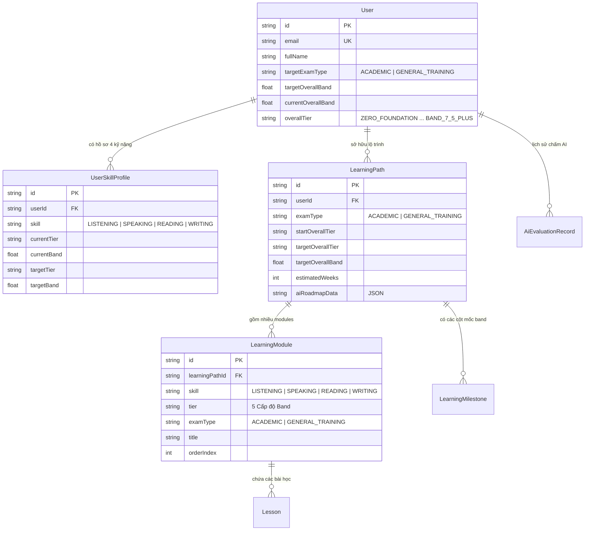

# 🎓 IELTS Master AI - Full-stack Architecture & Core Foundation

Hệ thống luyện thi IELTS cá nhân hóa được hỗ trợ bởi Trí tuệ Nhân tạo (AI Engine), thiết kế theo tiêu chuẩn kỹ thuật **Senior Full-stack Architecture**.

---

## 📌 Tổng quan kiến trúc hệ thống

Dự án được cấu trúc theo mô hình **Monorepo / Clean Architecture** với tính phân tách rõ ràng giữa Frontend, Backend và Shared Domain Types:

```
APP IELST/
├── backend/                        # Backend REST API (Node.js, Express, TypeScript, Prisma)
│   ├── .env                        # Chứa cấu hình bảo mật & AI_API_KEY
│   ├── .env.example                # File mẫu biến môi trường cho team
│   ├── prisma/
│   │   ├── schema.prisma           # Database Schema (User, LearningPath, SkillProfile, AiLog...)
│   │   └── dev.db                  # Local SQLite database (hoặc PostgreSQL trong production)
│   ├── src/
│   │   ├── config/
│   │   │   └── env.config.ts       # Centralized Environment Validator
│   │   ├── common/
│   │   │   └── enums/              # ExamType, BandLevel, SkillType
│   │   ├── services/
│   │   │   └── ai/
│   │   │       ├── ai.helper.ts    # AI API Helper dùng chung (Retry, Timeout, JSON parse, Domain Helpers)
│   │   │       └── ai.types.ts     # DTOs & Schema định nghĩa cho AI Calls
│   │   ├── modules/
│   │   │   ├── ai/                 # Endpoints AI: Generate, Roadmap, Writing, Speaking
│   │   │   ├── learning-path/      # Quản lý lộ trình học tập, filter theo ExamType & Band
│   │   │   └── user/               # Quản lý hồ sơ học viên & 4 kỹ năng
│   │   ├── database/
│   │   │   ├── prisma.client.ts    # Prisma Client Singleton
│   │   │   └── seed.ts             # Seeding dữ liệu mẫu cho Academic & General Training
│   │   ├── app.ts                  # Express App Config (CORS, Helmet, Error Handling)
│   │   └── server.ts               # HTTP Server Bootstrap
│   ├── tsconfig.json
│   └── package.json
│
├── frontend/                       # Frontend Web App (Next.js / React 19, Tailwind CSS, TypeScript)
│   ├── src/
│   │   ├── constants/
│   │   │   └── ielts.constants.ts  # UI Badges, Color palette, Metadata 5 cấp độ & 2 hình thức thi
│   │   ├── services/
│   │   │   └── api/
│   │   │       ├── api-client.ts   # Axios client với Interceptors & Error handler
│   │   │       ├── learning-path.api.ts
│   │   │       └── ai.api.ts       # Client-side AI trigger methods
│   │   └── types/
│   │       └── ielts.ts            # Type Safety kế thừa từ Shared Module
│   ├── tsconfig.json
│   └── package.json
│
├── shared/                         # Shared Contract dùng chung giữa Frontend & Backend
│   ├── types/
│   │   └── ielts.ts                # Enums (ExamType, BandLevel, SkillType) & Interfaces
│   └── constants/
│       └── ielts-levels.ts         # Chi tiết ma trận 5 cấp độ học tập cho 4 kỹ năng
│
└── README.md                       # Tài liệu thiết kế hệ thống chi tiết
```

---

## 🎯 1. Cấu hình Biến Môi trường & AI API Helper Dùng Chung

### 1.1. Cấu hình `.env`
Đã cấu hình tại `backend/.env`:
```env
AI_API_KEY="YOUR_GEMINI_API_KEY_OR_ENV"
AI_API_BASE_URL="https://generativelanguage.googleapis.com/v1beta"
AI_MODEL_NAME="gemini-1.5-pro"
AI_REQUEST_TIMEOUT_MS=30000
PORT=5000
NODE_ENV=development
```

### 1.2. AI Helper Core Function (`backend/src/services/ai/ai.helper.ts`)
Hàm `callAiApi<T>()` được thiết kế đạt tiêu chuẩn Enterprise:
- **Xác thực An toàn**: Tự động inject khóa bảo mật qua header `x-goog-api-key` và query param.
- **Che dấu Khóa (Masking)**: Khóa API được che dấu (`AQ.***...***`) trong mọi console/system log để bảo vệ bảo mật.
- **Tự động Thử lại (Exponential Backoff)**: Tự động retry khi gặp lỗi mạng tạm thời hoặc mã lỗi `429 Too Many Requests` / `503 Service Unavailable`.
- **Hủy theo Thời gian thực (AbortController Timeout)**: Tự động ngắt request nếu vượt quá `AI_REQUEST_TIMEOUT_MS` (mặc định 30 giây).
- **Chuẩn hóa Phản hồi JSON**: Tự động bóc tách Markdown codeblock (```json ... ```) và parse thành Object có kiểu dữ liệu (Type-safe).
- **Tích hợp sẵn Domain Helpers**:
  - `generatePersonalizedRoadmap()`: Sinh lộ trình thích ứng theo năng lực học viên.
  - `evaluateIeltsWriting()`: Chấm điểm bài viết Task 1 & Task 2 theo 4 tiêu chí chấm thi quốc tế (TR, CC, LR, GRA).
  - `evaluateIeltsSpeaking()`: Đánh giá câu trả lời Speaking theo tiêu chuẩn Giám khảo IELTS.

---

## 🏛️ 2. Thiết kế Database Schema: User & LearningPath

### 2.1. Hỗ trợ 2 Hình thức thi IELTS:
1. **Academic (ACADEMIC)**:
   - *Đối tượng*: Dành cho bậc đại học, sau đại học hoặc mục đích chuyên môn (Bác sĩ, Kỹ sư, Giảng viên...).
   - *Đặc thù*: Reading gồm các văn bản học thuật chuyên sâu; Writing Task 1 phân tích dữ liệu biểu đồ, bảng biểu, quy trình hoặc bản đồ (Line, Bar, Pie, Map, Process).
2. **General Training (GENERAL_TRAINING)**:
   - *Đối tượng*: Dành cho đào tạo nghề, trung học hoặc định cư (Canada Express Entry, Úc, New Zealand...).
   - *Đặc thù*: Reading gồm các mẩu tin tức, thông báo đời thường, hợp đồng lao động; Writing Task 1 viết thư (Formal, Semi-formal, Informal letter).

### 2.2. Prisma Schema Relationships


---

## 📊 3. Hệ thống Phân tầng 5 Cấp độ Học tập theo Band điểm

Hệ thống chuẩn hóa 5 cấp độ áp dụng cho cả 4 kỹ năng (**Listening, Speaking, Reading, Writing**):

| Cấp độ (Band Level) | Tên hiển thị | CEFR tương đương | Dải Band điểm | Trọng tâm học tập cốt lõi theo 4 kỹ năng |
| :--- | :--- | :--- | :--- | :--- |
| **ZERO_FOUNDATION** | **Mất gốc** | Pre-A1 / A1 | `0.0 - 3.0` | **Nghe:** Bảng chữ cái, số đếm, tên riêng.<br>**Nói:** 44 âm IPA, bật ending sounds, giới thiệu căn bản.<br>**Đọc:** 8 thì cơ bản, nhận diện cấu trúc câu đơn.<br>**Viết:** Viết đúng chính tả, viết câu đơn hoàn chỉnh. |
| **BELOW_4_5** | **< 4.5** | A2 / B1 Low | `3.5 - 4.0` | **Nghe:** Form/Note Completion Section 1, kỹ thuật dự đoán từ.<br>**Nói:** Trả lời Part 1 (2-3 câu), kiểm soát trọng âm từ.<br>**Đọc:** Rèn Skimming ý chính & Scanning từ khóa.<br>**Viết:** Cấu trúc đoạn PEEL, câu ghép liên từ, form thư cơ bản. |
| **BAND_4_5_TO_6_0** | **4.5 - 6.0** | B1 / B2 | `4.5 - 6.0` | **Nghe:** Multiple choice, Map Labelling, nhận diện Paraphrase.<br>**Nói:** Part 2 nói 2 phút liền mạch theo khung thời gian, Part 3 mở rộng.<br>**Đọc:** Matching Headings, Yes/No/Not Given, kiểm soát 60 phút.<br>**Viết:** Viết bài luận Task 2 đủ 4 đoạn (250 từ); Task 1 chọn số liệu nổi bật. |
| **BAND_6_0_TO_7_5** | **6.0 - 7.5** | B2 / C1 | `6.0 - 7.5` | **Nghe:** Độc thoại học thuật Section 4, nắm bắt Signposting words.<br>**Nói:** Bàn luận vấn đề xã hội Part 3, dùng Idioms tự nhiên, ngữ điệu.<br>**Đọc:** Xử lý từ mới qua ngữ cảnh, bắt bẫy Cambridge, tốc độ cao.<br>**Viết:** Đảo ngữ, câu chẻ, Collocations học thuật sắc sảo, mạch lạc cao. |
| **BAND_7_5_PLUS** | **7.5+** | C1 / C2 | `7.5 - 9.0` | **Nghe:** Nghe tốc độ 1.25x - 1.5x bài giảng TED, loại bỏ 100% lỗi chính tả.<br>**Nói:** Phản xạ tự nhiên như người bản xứ, tư duy phản biện sắc bén.<br>**Đọc:** Đạt 38-40/40 câu dưới 50 phút với các tài liệu khoa học hàn lâm.<br>**Viết:** Phong cách viết đạt chuẩn xuất bản học thuật quốc tế. |

---

## 🎯 4. Tính Năng Test Đầu Vào & Gợi Ý Lộ Trình Theo Band (Mới Cập Nhật)

### 4.1. Logic Tính Điểm & Quy Tắc Làm Tròn Chuẩn Quốc Tế
Điểm Overall Band Score được tính theo trung bình cộng 4 kỹ năng và làm tròn theo quy chế chính thức của Cambridge & IDP:
- **Trung bình cộng**: $\text{rawAverage} = \frac{\text{Listening} + \text{Reading} + \text{Writing} + \text{Speaking}}{4}$
- **Phần thập phân (Fraction)**:
  - `< 0.25`: Làm tròn xuống số nguyên (vd: 6.125 -> 6.0)
  - `0.25 <= fraction < 0.75`: Làm tròn thành mức .5 (vd: 6.25 -> 6.5, 6.625 -> 6.5)
  - `>= 0.75`: Làm tròn lên số nguyên tiếp theo (vd: 6.75 -> 7.0, 6.875 -> 7.0)

### 4.2. Bảng 9 Band Điểm Chuẩn IELTS & Ngưỡng Vàng Du Học 6.0 - 6.5
- Từ **Band 0** (*Did not attempt the test*), **Band 1** (*Non User*), **Band 4** (*Limited User*), **Band 6** (*Competent User*) đến **Band 9** (*Expert User*).
- **Lưu ý Ngưỡng 6.0 - 6.5**: Là điều kiện tối thiểu bắt buộc để nhập học trực tiếp bậc Đại học (6.0) và Thạc sĩ (6.5) tại hơn 85% các trường đại học tại Anh, Úc, Canada, Mỹ. Dưới ngưỡng này, học viên bắt buộc phải học thêm khóa tiếng Anh bổ trợ (Pre-sessional English) tốn kém từ $3,000 - $8,000 USD.

### 4.3. Thuật Toán Phân Bổ Kho Học Liệu 5 Cấp Độ
Hệ thống tự động liên kết kho sách và bài tập phù hợp nhất với năng lực:
- **Mức "Mất gốc":** *Basic Tactics for Listening, Listen Carefully, English Unlimited A1/A2, English Pronunciation in Use*.
- **Mức "< 4.5":** *Basic IELTS Series, Bridge to IELTS 3.5-4.5, Get Ready For IELTS, Developing Tactics for Listening, Succeed in IELTS Speaking*.
- **Mức "4.5 - 6.0":** *Cambridge IELTS 3 - 9 (có sẵn trên máy), Complete IELTS 4.0-5.0, Mindset for IELTS 1, Collins for IELTS, Hackers IELTS*.
- **Mức "6.0 - 7.5":** *IELTS Advantage, Complete IELTS 5.0-6.5, Mindset for IELTS 2, Target 7.0, Cambridge IELTS Trainer, IELTS Practice Test Plus*.
- **Mức "7.5+":** *Complete IELTS 6.5-7.5, Mindset for IELTS 3, Mission IELTS 2 Academic, English Unlimited C1, Objective IELTS Advanced*.

### 4.4. Giao Diện Dashboard Tương Tác Trực Tuyến
Dashboard tương tác trực tiếp đã được tích hợp tại:
- React Component: `frontend/src/components/dashboard/IeltsDashboard.tsx`
- Interactive HTML Generative UI Artifact: `ielts_dashboard.html`

---

## 🎧 5. Mô-đun Luyện Thi IELTS Listening Chuẩn Cambridge (Mới Cập Nhật)

### 5.1. Khảo Thí Chuẩn Cambridge 40 Câu & Bộ Đếm Thời Gian Kép
- **4 Sections Khảo Thí**:
  - Section 1 (Câu 1-10): Giao tiếp xã hội đời sống (Notes/Form completion).
  - Section 2 (Câu 11-20): Thông tin công cộng (Multiple choice & Map labelling).
  - Section 3 (Câu 21-30): Thảo luận học thuật (Table completion & Classification).
  - Section 4 (Câu 31-40): Độc thoại bài giảng đại học (Sentence/Notes completion).
- **Bộ đếm thời gian kép 40 phút**: 30 phút nghe bài thi + 10 phút chuyển đáp án (*Transfer Answers Phase*).
- **Cơ chế khóa Audio thi thử**: Trình phát chỉ cho phép nghe **1 lần duy nhất** cho mỗi Section, không hỗ trợ tua lùi để mô phỏng 100% áp lực phòng thi thật.

### 5.2. Hỗ Trợ Đầy Đủ 7 Dạng Bài Khảo Thí
1. `Multiple Choice` (Lựa chọn đơn & đa đáp án)
2. `Short-Answer Questions`
3. `Sentence Completion`
4. `Notes / Form / Chart / Table Completion`
5. `Labelling a Diagram / Map Labelling`
6. `Classification`
7. `Matching`

### 5.3. Bộ Kiểm Tra Giới Hạn Từ Thời Gian Thực (Word Limit Validator)
- Tự động nhận diện chỉ dẫn: `NO MORE THAN THREE WORDS AND/OR A NUMBER`, `NO MORE THAN ONE WORD`, v.v.
- Đếm từ và số theo quy chế Cambridge (từ ghép gạch nối như *part-time* tính là 1 từ).
- Hiển thị cảnh báo tức thì ngay trên ô input khi học viên gõ vượt quá giới hạn.

### 5.4. Trình Chấm Điểm Cambridge Tự Động (Auto-grading Parser)
Định nghĩa tại `shared/utils/cambridge-grading.ts`:
- **Thang điểm**: 1 điểm cho mỗi câu đúng, không có nửa điểm (0 hoặc 1).
- **Case-insensitive**: Không phân biệt chữ hoa/thường.
- **Từ điển song ngữ US / UK**: Tự động chấp nhận cả *centre* và *center*, *favourite* và *favorite*, *metres* và *meters*, *colour* và *color*...
- **Xử lý cú pháp đáp án Cambridge**:
  - `(the) garden`: Từ trong ngoặc đơn là tùy chọn (*garden* hoặc *the garden* đều được 1 điểm).
  - `police station/office`: Dấu gạch chéo đơn là từ thay thế trong cụm (*police station* hoặc *police office*).
  - `14th July // July 14th`: Dấu gạch chéo kép là các phương án đúng độc lập.

### 5.5. Bảng Tư Vấn 3 Mức Điểm & Trợ Lý AI Tapescript Explainer
- **0 - 17 Điểm (Band 1.0 - 5.0)**: Cần học thêm nhiều trước khi thi (chưa nên đăng ký thi thật, tập trung nghe chép chính tả và lấy trọn 10/10 Section 1).
- **18 - 27 Điểm (Band 5.5 - 6.5)**: Có thể đạt yêu cầu nhưng nên luyện thêm (tiệm cận hoặc vừa chạm ngưỡng du học, cần tránh bẫy đổi ý Section 3 và luyện Map labelling).
- **28 - 40 Điểm (Band 7.0 - 9.0)**: Sẵn sàng đi thi (thành thạo bài giảng học thuật Section 4, tự tin đạt điểm cao vào các đại học hàng đầu thế giới).
- **Trợ lý AI Tapescript**: Tích hợp gọi AI Gemini phân tích câu trích dẫn trong băng ghi âm, bẫy distractor và từ vựng đồng nghĩa (*Paraphrasing*).

- Giao diện phòng thi trực tuyến: [`ielts_listening_exam.html`](file:///C:/Users/ADMIN/.gemini/antigravity/brain/abccf166-313f-4317-ada3-f5e28bf8cc96/ielts_listening_exam.html)

---

## 📖 6. Mô-đun Luyện Thi IELTS Reading Split-Screen (Mới Cập Nhật)

### 6.1. Thiết Kế Giao Diện Split-Screen Chuẩn Computer-delivered IELTS
- **Khung bên trái (Left Pane):**
  - Hiển thị 3 Passages với độ khó tăng tiến (Passage 1: Sinh thái học; Passage 2: Kiến trúc đô thị thẳng đứng; Passage 3: Khảo cổ học nhận thức & Ngôn ngữ).
  - **Công cụ Text Highlighter**: Cho phép học viên bôi đen trực tiếp văn bản để tô sáng bằng bút dạ (Vàng, Xanh lá, Cam) và xóa highlight.
- **Khung bên phải (Right Pane):**
  - Hiển thị 40 câu hỏi bài thi chia theo từng Passage.
  - **Đồng hồ đếm ngược 60 phút** không có thời gian chuyển đáp án (chuẩn quy chế thi IELTS Reading).
  - Tích hợp chuyển đổi linh hoạt giữa đề **Academic** và **General Training**.

### 6.2. Hỗ Trợ Đầy Đủ 6 Dạng Bài Khảo Thí
1. `Matching Paragraph Headings` (chọn số La Mã: i - x cho các đoạn văn).
2. `True / False / Not Given` (Kiểm chứng dữ kiện thực tế).
3. `Yes / No / Not Given` (Phân tích quan điểm & ý kiến của tác giả).
4. `Summary Completion` (Điền từ vào đoạn tóm tắt nội dung).
5. `Multiple Choice` (Lựa chọn đáp án đơn & đa lựa chọn).
6. `Classification` (Phân loại thông tin theo nhóm tiêu chí).

### 6.3. AI Trợ Giảng Cá Nhân Hóa Theo Cấp Độ Band Học Viên
Tích hợp trực tiếp qua endpoint `POST /api/v1/reading/ai-mentor` kết nối Gemini 3.5 Flash:
- **Dành cho học viên Band < 4.5 và 4.5 - 6.0 (Cơ bản / Trung cấp):**
  - 🇻🇳 Dịch nghĩa tiếng Việt mượt mà câu văn khó chứa manh mối đáp án.
  - 📖 Giải thích từ vựng cốt lõi kèm phiên âm IPA và nghĩa tiếng Việt.
  - 🔄 Chỉ rõ cặp từ đồng nghĩa (*Paraphrase pairs*) đối chiếu trực tiếp giữa câu hỏi và bài đọc.
- **Dành cho học viên Band 6.0 - 7.5 và 7.5+ (Nâng cao / Chuyên sâu):**
  - 🧠 Phân tích cấu trúc lập luận học thuật (*Logical argument structure*) và phong thái tác giả (*Author's stance & tone*).
  - ⚠️ **Bóc tách bẫy gây nhiễu tinh vi giữa FALSE/NO và NOT GIVEN**: Chỉ rõ ranh giới giữa mâu thuẫn trực tiếp (*Direct contradiction*) và suy diễn thiếu dữ kiện (*Unsubstantiated deduction*).
  - 🏆 Chiến thuật kiểm soát từ hạn định (*Quantifiers*) để chinh phục Band 8.0 - 9.0.

- Giao diện phòng thi trực tuyến: [`ielts_reading_exam.html`](file:///C:/Users/ADMIN/.gemini/antigravity/brain/abccf166-313f-4317-ada3-f5e28bf8cc96/ielts_reading_exam.html)

---

## ✍️ 7. Mô-đun Luyện Thi IELTS Writing & AI Examiner (Mới Cập Nhật)

### 7.1. Giao Diện Làm Bài 2 Chế Độ Chuẩn Khảo Thí
- **Task 1 (Khuyến nghị 20 phút - Tối thiểu 150 từ):**
  - Academic: Biểu đồ đường (Line graph), bảng biểu, sơ đồ kèm bảng số liệu rõ ràng (yêu cầu tóm tắt, chọn lọc số liệu nổi bật & so sánh).
  - General Training: Viết thư trang trọng (Formal letter of complaint) kèm 3 yêu cầu cụ thể.
- **Task 2 (Khuyến nghị 40 phút - Tối thiểu 250 từ - Trọng số điểm x2):**
  - Đề bài nghị luận xã hội / học thuật (Discuss both views & Opinion).
  - Công thức tính điểm Writing chính thức: $\text{Writing Band} = \frac{\text{Task 1} + 2 \times \text{Task 2}}{3}$.

### 7.2. Bộ Đếm Từ & Phát Hiện Lỗi Văn Phong Học Thuật Thời Gian Thực
- Thanh tiến trình độ dài tự động đổi màu (Đỏ $\rightarrow$ Cam $\rightarrow$ Xanh lục khi đủ từ).
- **Phát hiện lỗi viết tắt (*Contractions*) và từ ngữ thân mật (*Informal expressions*):** Cảnh báo tức thì nếu người viết dùng `don't`, `can't`, `it's`, `kids`, `a lot of`, `wanna`, `gonna`...

### 7.3. AI Examiner Chấm Chữa Chi Tiết & Nâng Cấp Bài Mẫu
Tích hợp trực tiếp qua endpoint `POST /api/v1/writing/evaluate` kết nối Gemini 3.5 Flash:
- **Chấm điểm 4 tiêu chí chính thức trên thang 1-9:**
  1. *Task Achievement / Task Response* (Mức độ hoàn thành yêu cầu & độ dài từ).
  2. *Coherence & Cohesion* (Tổ chức đoạn văn & từ nối 'signpost').
  3. *Lexical Resource* (Độ phong phú từ vựng & Collocations).
  4. *Grammatical Range & Accuracy* (Cấu trúc câu phức & độ chuẩn xác).
- **Nhận xét chính thức theo chuẩn Examiner's Comment của sách Cambridge.**
- **Tự động sinh bài viết mẫu (Model Answer Band 7.5+ - 8.0):** Nâng cấp trực tiếp từ chính ý tưởng gốc của học viên kèm bảng phân tích so sánh trước/sau (*Before & After*).

- Giao diện phòng thi trực tuyến: [`ielts_writing_examiner.html`](file:///C:/Users/ADMIN/.gemini/antigravity/brain/abccf166-313f-4317-ada3-f5e28bf8cc96/ielts_writing_examiner.html)

---

## 🎙️ 8. Mô-đun Luyện Thi IELTS Speaking 20 Chủ Điểm & Phòng Thi Ảo AI (Mới Cập Nhật)

### 8.1. Thư Viện Ôn Tập Trọn Vẹn 20 Chủ Điểm Thông Dụng
Hỗ trợ đầy đủ 20 chủ đề khảo thí phổ biến nhất trong các đề thi Cambridge & IDP thực tế:
*Animals, Art, Celebrations, Clothes, Environment, Famous People, Food, Friends, Holidays, Music, Nation and Culture, Routines, Science, Shopping, Social Media, Sport, Technology, Transport, Weather, Study.*

Mỗi chủ đề đều trang bị **đầy đủ 4 thành phần hỗ trợ học viên chinh phục Band 6+**:
1. **Useful Collocations and Vocabulary:** Kho cụm từ học thuật C1/C2 có giải nghĩa tiếng Việt, phân loại Band điểm và câu ví dụ minh họa ngữ cảnh.
2. **Suggested Ideas:** Gợi ý phát triển ý tưởng đa chiều phân bổ chi tiết theo từng bullet point trên Task Card (Cue Card).
3. **Suggested Natural Phrases:** Các cấu trúc mở đầu và diễn đạt tự nhiên chia theo nhóm mục đích giao tiếp (*Starting Off, Buying Time, Giving Opinion, Contrasting, Speculating*).
4. **Sample Answers:** Cặp bài nói mẫu đối chiếu trực tiếp giữa mức độ trung cấp (**Band 6.0**) và nâng cao (**Band 8.0+**) cho cả Part 1 và Part 2.

### 8.2. Phòng Thi Ảo Mô Phỏng 3 Parts Có Thu Âm Giọng Nói (Speech-to-Text)
- **Part 1 (Phỏng vấn cá nhân 4-5 phút):** Bộ câu hỏi ngắn kèm gợi ý phát triển ý tưởng trực diện từ 2-4 câu.
- **Part 2 (Task Card / Cue Card 3-4 phút):**
  - Hiển thị Cue Card theo phong cách thẻ đề thi Cambridge chính thức.
  - Đồng hồ đếm ngược **1 phút chuẩn bị** tích hợp khung ghi chú nhanh (**Candidate Scratchpad**) để ghi chép từ khóa.
  - Tự động chuyển tiếp sang đồng hồ đếm giờ **2 phút thu âm bài nói** với hiệu ứng nhịp sóng âm thanh trực quan.
- **Part 3 (Thảo luận hai chiều chuyên sâu 4-5 phút):** Các câu hỏi mở rộng mang tính xã hội và tư duy trừu tượng C1+ gắn liền với chủ đề ở Part 2.
- **Bộ nhận diện giọng nói thời gian thực (Speech-to-Text):** Tích hợp Web Speech API chuyển đổi giọng nói tiếng Anh thành văn bản trực tiếp trên màn hình, hỗ trợ kiểm tra số lượng từ và tinh chỉnh linh hoạt.

### 8.3. AI Examiner Chấm Điểm 4 Tiêu Chí Chuẩn IELTS
Kết nối trực tiếp API Backend (`POST /api/v1/speaking/evaluate`) sử dụng mô hình Gemini 3.5 Flash:
1. **Fluency and Coherence (Độ trôi chảy & mạch lạc):** Đánh giá tốc độ nói, độ liền mạch, cách xử lý ngập ngừng và sử dụng liên từ.
2. **Lexical Resource (Vốn từ vựng):** Kiểm tra độ chính xác theo ngữ cảnh, collocations C1/C2, phrasal verbs và khả năng paraphrase.
3. **Grammatical Range and Accuracy (Ngữ pháp đa dạng & chuẩn xác):** Đánh giá sự phong phú của các cấu trúc câu phức, mệnh đề quan hệ, câu điều kiện và chia thì.
4. **Pronunciation (Ngữ âm & Phát âm):**
   - Phân tích trọng âm từ (**Word Stress**) của các từ đa âm tiết, chỉ rõ phiên âm IPA chuẩn xác và các lỗi nhấn sai người Việt hay mắc.
   - Nhận xét ngữ điệu (**Intonation**) và kỹ thuật nối âm (**Connected Speech / Linking Sounds**).
- **Examiner's Official Feedback:** Lời phê chuyên môn sắc nét theo chuẩn giám khảo Cambridge/IDP.
- **Personalized Upgraded Band 8.0 Transcript:** Viết lại toàn văn bài nói mẫu đạt Band 8.0 phát triển trực tiếp từ chính ý tưởng gốc của thí sinh.

- Giao diện phòng thi trực tuyến: [`ielts_speaking_virtual_room.html`](file:///C:/Users/ADMIN/.gemini/antigravity/brain/abccf166-313f-4317-ada3-f5e28bf8cc96/ielts_speaking_virtual_room.html)

---

## 👑 9. IELTS GO! - Khung Giao Diện Web App, Gamification & Trợ Lý Ảo (Mới Cập Nhật)

Lấy cảm hứng từ kiến trúc trải nghiệm trực quan của **NIHONGO GO!**, dự án ra mắt phiên bản web **IELTS GO!** (*Học IELTS Chuẩn Cambridge & AI Examiner Victoria*):

### 9.1. Khung Giao Diện Chính (App Shell)
- **Header 2 tầng siêu nhạy (Responsive 2-Row Design):**
  - Brand Logo vương miện hoàng gia chuyển động lắc nhẹ (Gentle wobble).
  - Nút chuyển đổi 2 hệ thi độc lập: 🎓 **Academic** (Đại học/Thạc sĩ) vs 💼 **General Training** (Đào tạo nghề/Định cư).
  - Tích hợp công tắc âm thanh Web Audio Synthesizer (🔊 / 🔇) và nút mở hồ sơ học viên (📊 Hồ sơ).
- **Thanh Gamification HUD Ribbon lưu trữ LocalStorage:**
  1. 🎯 **Tiến độ thuộc từ vựng 20 Chủ điểm:** Đo lường mục tiêu 1000 từ C1/C2 (Ví dụ: `0% - 0/1000 từ`).
  2. 🔥 **Chuỗi ngày học liên tục (Daily Streak):** Thắp sáng ngọn lửa chuyên cần, tự động kiểm tra mốc thời gian học hàng ngày.
  3. 👑 **Vương miện thưởng tích lũy (Crowns):** Thưởng khi duy trì streak hoặc hoàn thành bài, dùng để mở khóa các phân tích gợi ý thi cử chuyên sâu.
  4. ⭐ **Điểm kinh nghiệm (EXP):** Tích lũy qua bài tập và tự động thăng cấp Level học viên.
  5. 🎖️ **Cấp độ học viên theo 5 mốc Band:** Phân tầng từ *Mất gốc -> Band < 4.5 -> Band 4.5-6.0 -> Band 6.0-7.5 -> Band 7.5+ Expert Master*.

### 9.2. Sidebar Trợ Lý Đồng Hành (Aside Mascot Engine)
- **Barnaby Sensei (Chú chó Corgi Hoàng gia Anh 🐕):** Trợ lý trung thành, cổ vũ tinh thần học tập với các biểu cảm sinh động (*idle, happy, thinking, encouraging*).
- **Giám khảo Victoria AI (Senior Cambridge Examiner 👩‍🏫):** Giám khảo Oxford mực thước, sắc bén trong lời khuyên học thuật.
- **Speech Bubble tương tác:** Tự động phát ngẫu nhiên các mẹo thi độc quyền cho cả 4 kỹ năng (*Listening, Reading, Writing, Speaking*) và chúc mừng khi học viên đạt combo hoặc lên cấp.

### 9.3. Thanh Điều Hướng (Nav) & Hộp Thoại Lưới 10 Chế Độ Học IELTS
- Thanh tab trượt ngang có nút mũi tên cuộn `‹` và `›` mượt mà.
- Nút **☰ 10 Chế Độ** kích hoạt Modal lưới hiển thị trực quan 10 chế độ học:
  1. 🗺️ **Lộ Trình 5 Band Điểm** (Roadmap)
  2. 🃏 **Flashcard 3D** (Spaced Repetition)
  3. 🎮 **Game Đoán Từ** (Hot Game)
  4. 🧩 **Lật Thẻ Trí Nhớ** (Paraphrase Match & C1 Collocations)
  5. 🎤 **Test Phát Âm & Speaking AI** (AI Voice & IPA)
  6. ✍️ **IELTS Writing Studio** (Live Word Count & Examiner Feedback)
  7. 📐 **Ngữ Pháp & Ghép Câu Học Thuật** (Academic Grammar)
  8. 👩‍🏫 **Giám Khảo Victoria AI** (Khảo bài 1-on-1 Oral Interrogation)
  9. 🏆 **Thi Thử IELTS** (Cấp chứng chỉ TRF)
  10. 📖 **Sổ Tay Từ Vựng & Giáo Trình** (Cambridge Vault)

### 9.4. Cấu Hình AI API Service
- Khóa AI API chung: `process.env.AI_API_KEY` (hoặc cấu hình trực tiếp qua AI Service)
- Tích hợp service `IeltsAiService` (`js/ai-service.js`) dùng chung cho:
  - **Chấm điểm (Scoring):** Đánh giá Writing/Speaking theo 4 tiêu chí.
  - **Khảo bài 1-on-1:** Đối thoại phỏng vấn trực tiếp với Giám khảo Victoria.
  - **Giải thích đáp án:** Phân tích bẫy, trích xuất tapescript và bảng paraphrase.

- File chạy nhanh: [`Mo_App_IELTS_GO.bat`](file:///c:/Users/ADMIN/Documents/APP%20IELST/Mo_App_IELTS_GO.bat)
- Web App Shell: [`index.html`](file:///c:/Users/ADMIN/Documents/APP%20IELST/index.html)
- Generative UI Artifact: [`ielts_go_app_shell.html`](file:///C:/Users/ADMIN/.gemini/antigravity/brain/abccf166-313f-4317-ada3-f5e28bf8cc96/ielts_go_app_shell.html)

---

## 🗺️ 10. Chế Độ 1: Lộ Trình 5 Band Điểm & Kho Giáo Trình Chuẩn (Mới Cập Nhật)

### 10.1. Bản Đồ 5 Chặng Đường (Unlockable Stages)
1. **Chặng 1: Mất gốc (Foundation - Band 0-3.5):** 4 bài học vỡ lòng (Routines, Food, Friends, Animals).
2. **Chặng 2: Sơ cấp (Pre-Intermediate - Band < 4.5):** 4 bài học tiếp cận đề thi (Shopping, Clothes, Weather, Sport).
3. **Chặng 3: Trung cấp (Intermediate - Band 4.5-6.0):** 4 bài học bứt phá câu phức & Task 1 (Holidays, Celebrations, Music, Transport).
4. **Chặng 4: Nâng cao (Upper-Intermediate - Band 6.0-7.5 - Chuẩn Du Học):** 4 bài học tư duy phản biện & Task 2 (Technology, Environment, Social Media, Art).
5. **Chặng 5: Chuyên sâu (Advanced / Expert - Band 7.5+ Master):** 4 bài học học thuật C1/C2 đỉnh cao (Science, Nation & Culture, Famous People, Study).

### 10.2. Cấu Trúc Bảng Nhiệm Vụ Vượt Ải 3 Bước (Mission Modal)
Mỗi bài học yêu cầu hoàn thành trọn vẹn 3 nhiệm vụ để mở khóa bài tiếp theo:
- **Nhiệm vụ 1: 💎 Học Từ Vựng (Vocabulary Mastery):** Từ vựng C1/C2, phát âm IPA, nghĩa tiếng Việt, câu ví dụ ngữ cảnh và nút phát âm Web Speech Audio (+25 EXP).
- **Nhiệm vụ 2: 📐 Luyện Cấu Trúc Câu (Grammar Puzzle):** Kéo ghép câu học thuật (Mệnh đề quan hệ, câu chẻ, đảo ngữ) có kiểm tra cú pháp và giải thích ngữ pháp tức thì (+25 EXP).
- **Nhiệm vụ 3: 👩‍🏫 Khảo Bài AI Cùng Victoria (AI Mini-Exam):** Thử thách phỏng vấn phản biện Cambridge, có AI Examiner thẩm định nhận xét chi tiết và mẹo từ vựng C1 (+50 EXP, +5 👑).
- **Cơ chế mở khóa linh hoạt:** Tự động mở khóa bài học kế tiếp (N+1) sau khi vượt ải hoặc dùng **10 Vương Miện 👑** để mở khóa sớm bất kỳ bài học nào.

### 10.3. Tích Hợp Kho Giáo Trình Tuyển Chọn Theo 5 Chặng & 4 Kỹ Năng
Kho tài liệu đầy đủ tích hợp bộ lọc kỹ năng (*Listening, Reading, Writing, Speaking, All*):
- **Mất gốc:** *Basic Tactics for Listening, Listen Carefully, English Unlimited A1/A2, English Pronunciation in Use Elementary*.
- **Band < 4.5:** *Developing Tactics for Listening, Intensive Listening, Basic IELTS Series, Bridge to IELTS 3.5-4.5, Get Ready For IELTS, Succeed in IELTS Speaking*.
- **Band 4.5 - 6.0:** *Focus On Academic Skills, Complete IELTS 4.0-5.0, The Official Cambridge Guide to IELTS, Mindset for IELTS 1, Collins for IELTS Series, Hackers IELTS, Barron's Writing for IELTS, Marvellous Techniques for IELTS Writing*.
- **Band 6.0 - 7.5:** *IELTS Advantage (Writing/Reading/Speaking & Listening), Complete IELTS 5.0-6.5, Mission IELTS 1 Academic, Mindset for IELTS 2, Target Band 7, Cambridge IELTS Trainer 1 & 2, IELTS Practice Test Plus 1-3, 31 High-scoring Formulas for Speaking*.
- **Band 7.5+:** *Complete IELTS 6.5-7.5, Mindset for IELTS 3, Mission IELTS 2 Academic, English Unlimited C1, Objective IELTS Advanced, Cambridge IELTS Practice Tests 15 - 19*.

---

## 🃏 11. Chế Độ 2: Flashcard 3D (Thuật Toán Lặp Lại Ngắt Quãng SRS & Lật Thẻ 3D)

### 11.1. Hiệu Ứng Lật Thẻ 3 Chiều (CSS 3D Flip)
- **Mặt trước (Front Face):**
  - Hiển thị từ vựng/collocation chữ to nổi bật, huy hiệu từ loại (noun, verb, collocation, etc.).
  - Huy hiệu cấp độ Band (`4.5 - 6.0`, `6.0 - 7.5`, `7.5+`) và phân loại CEFR (`B1`, `B2`, `C1`, `C2`).
  - Hình minh họa SVG trực quan đại diện theo từng chủ đề và từ vựng.
  - Hai nút phát âm riêng biệt: **🇬🇧 UK Audio (Chuẩn Oxford)** và **🇺🇸 US Audio** qua Web Speech Synthesis API.
- **Mặt sau (Back Face):**
  - Phiên âm quốc tế IPA đầy đủ cả hai giọng UK và US.
  - Đánh dấu trọng âm từ vựng (`Word Stress`) rõ ràng trực quan.
  - Khung định nghĩa tiếng Việt nổi bật và định nghĩa học thuật chuẩn Cambridge.
  - Thẻ từ đồng nghĩa (*Synonyms / Paraphrase*) có thể nhấp để nghe phát âm ngay.
  - Danh sách cụm *Collocations* thường đi kèm trong đề thi IELTS.
  - Câu ví dụ chuẩn phong cách Cambridge kèm bản dịch tiếng Việt và nút phát âm cả câu.

### 11.2. Thao Tác & Gamification Tương Tác
- Nút **"Đã thuộc" (Mastered):** Tự động cộng tiến độ vào thanh 🎯 trên Header HUD, thưởng **+10 EXP**, phát âm thanh chuông "Ding-dong" và linh vật Barnaby cổ vũ.
- Nút **"Cần ôn lại" (Review):** Giữ từ trong hàng đợi luyện tập và đánh dấu trạng thái ôn tập.
- **Phím tắt tiện lợi (Keyboard Shortcuts):**
  - `Space`: Lật thẻ qua lại
  - `←` / `→`: Chuyển thẻ trước / sau
  - `1`: Đánh dấu Cần ôn lại
  - `2`: Đánh dấu Đã thuộc
  - `U`: Phát âm giọng UK 🇬🇧
  - `A`: Phát âm giọng US 🇺🇸
- **Tính năng nâng cao:** Xáo trộn thẻ ngẫu nhiên (`🎲 Shuffle`), Tự động phát (`▶️ Auto-play`), Đặt lại bộ lọc.

---

## 📖 12. Chế Độ 10: Sổ Tay Từ Vựng & Giáo Trình Tuyển Chọn (Vocab Vault)

### 12.1. Tra Cứu Tức Thì (Instant Search)
- Thanh tìm kiếm thời gian thực: Tra cứu theo từ tiếng Anh, phiên âm IPA, nghĩa tiếng Việt hoặc từ đồng nghĩa mà không cần tải lại trang.

### 12.2. Bộ Lọc 3 Tầng Thông Minh
- **Lọc theo 20 Chủ đề:** *Animals, Art, Celebrations, Clothes, Environment, Famous People, Food, Friends, Holidays, Music, Nation and Culture, Routines, Science, Shopping, Social Media, Sport, Technology, Transport, Weather, Study*.
- **Lọc theo Cấp độ Band:** Tất cả, Band 4.5 - 6.0, Band 6.0 - 7.5 (Du học), Band 7.5+ (Master).
- **Lọc theo Trạng thái học tập:** Tất cả, Đã thuộc (Mastered), Cần ôn lại (Review), Chưa thuộc (New).

### 12.3. Dashboard Thống Kê & Tích Hợp Đa Mô-đun
- 4 khối thẻ thống kê tổng quan: Tổng kho từ vựng, Số từ đã thuần thục (% hoàn thành đồng bộ với Header), Số từ cần ôn tập, Số từ mới chưa học.
- Nút tác vụ **"🃏 Luyện Trên Flashcard 3D":** Kích hoạt bộ lọc tương ứng và chuyển mượt sang Chế độ 2 để luyện tập ngay lập tức.
- Nút tác vụ **"📥 Xuất Sổ Tay":** Cho phép sao chép toàn bộ danh sách từ vựng đã lọc để in ấn hoặc lưu trữ cá nhân.
- Nút chuyển trạng thái nhanh ngay trên từng thẻ từ vựng với phản hồi âm thanh tức thì.

---

## 🎮 13. Chế Độ 3: Game Đoán Từ Phản Xạ & Combo System (Mới Cập Nhật)

### 13.1. 3 Hình Thức Câu Hỏi Ngẫu Nhiên
1. **🖼️ Nhìn Hình & Định Nghĩa Học Thuật:** Nhìn hình minh họa SVG phẳng và đọc định nghĩa học thuật chuẩn Cambridge -> Chọn từ vựng/collocation đúng trong 4 phương án A, B, C, D.
2. **🎧 Nghe Âm Thanh (Web Speech Audio):** Nghe loa phát âm từ vựng (ẩn chữ) bằng giọng Anh chuẩn Oxford -> Chọn từ vựng chính xác tương ứng.
3. **📝 Điền Collocation Vào Chỗ Trống:** Phân tích câu ví dụ thực tế trong đề thi IELTS có chỗ trống `________` -> Chọn cụm từ/collocation ăn điểm Lexical Resource phù hợp nhất.

### 13.2. Hệ Thống Đếm Ngược & Chuỗi Combo Ăn Điểm
- **Đồng hồ đếm ngược:** 15 giây (hoặc 10s/20s tùy chỉnh) với thanh thời gian đổi màu (*Xanh lá -> Vàng -> Đỏ cảnh báo*).
- **Hệ số nhân Combo liên tiếp:**
  - `Combo x2`: Nhân x1.5 điểm thưởng (+15 EXP).
  - `Combo x3`: Nhân x2.0 điểm thưởng (+20 EXP & +1 👑 Vương Miện).
  - `Combo x5+`: Nhân x3.0 điểm thưởng (+30 EXP & +2 👑/câu).
- **Bảng tổng kết & Ôn tập lỗi sai:** Hiển thị độ chính xác (%), Max Combo, tổng EXP & Crowns kiếm được, và danh sách các từ đã trả lời sai kèm nút phát âm để học viên ôn tập lại.

---

## 🧩 14. Chế Độ 4: Lật Thẻ Trí Nhớ (Paraphrase Memory Match - Mới Cập Nhật)

### 14.1. Lưới Thẻ Úp Hoàng Gia (3D Card Flip Grid)
- Hỗ trợ 2 kích thước bàn chơi: **Lưới 4x3 (12 thẻ • 6 cặp từ vựng)** và **Lưới 4x4 (16 thẻ • 8 cặp từ vựng)**.
- Mặt úp mang họa tiết vương miện hoàng gia Oxford; mặt ngửa hiển thị từ vựng, icon chủ đề và nhãn đối ứng.

### 14.2. Hai Chế Độ Ghép Cặp Tương Ứng
1. **🎯 Ghép [Từ Gốc] - [Từ Đồng Nghĩa Paraphrase]:** Rèn luyện phản xạ liên kết từ đồng nghĩa C1/C2 (ví dụ: *natural habitat* = *native territory*; *conspicuous consumption* = *ostentatious display of wealth*).
2. **🇻🇳 Ghép [Từ Học Thuật] - [Nghĩa Tiếng Việt]:** Củng cố khả năng hiểu nghĩa tức thời.

### 14.3. Cơ Chế Thưởng & Thống Kê Trận Đấu
- Ghép đúng: Thẻ phát sáng xanh ngọc, phát âm thanh chuông tươi sáng, tự động đọc phát âm qua Web Speech API và khóa thẻ.
- Ghép sai: Thẻ rung lắc và tự động úp lại sau 0.8s.
- Theo dõi thời gian thực: Thời gian bấm giờ (Stopwatch), Số lượt lật (Moves), Số cặp đã ghép.
- Màn hình chiến thắng: Đánh giá 1 - 3 Sao (⭐⭐⭐), cộng thưởng **+50 - 100 EXP** và **+3 - 5 👑 Vương Miện** trực tiếp vào Gamification HUD.
- Bảng tổng hợp toàn bộ các cặp Paraphrase vừa hoàn thành kèm nút loa phát âm tiện lợi.

---

## 🎤 15. Chế Độ 5: Test Phát Âm & Luyện Speaking AI (Mới Cập Nhật)

### 15.1. Hai Chế Độ Luyện Nói Linh Hoạt
1. **🎯 Luyện Phát Âm & Speaking Theo 20 Chủ Đề (Drill Mode):**
   - Thanh chọn ngang 20 chủ đề với bộ đếm tiến độ câu mục tiêu (ví dụ: `Câu 1 / 4`).
   - Cung cấp phiên âm quốc tế **IPA** và phân tích **Trọng âm / Ngữ điệu** (lên giọng Yes/No `↗`, xuống giọng Wh- `↘`).
   - Khung **Suggested Natural Phrases & Sample Answer:** Tuyển tập các cụm từ mở đầu tự nhiên (nhấp để chèn thẳng vào câu trả lời), so sánh bài mẫu song song **Band 6.0 vs Band 8.0+** kèm bản dịch tiếng Việt chuẩn xác.
   - Nút phát âm giọng đọc mẫu bản xứ (Native British Accent).
2. **🏛️ Phòng Thi Mô Phỏng 3 Parts (Full Exam Simulation):**
   - **Part 1:** Phỏng vấn phản xạ các chủ đề quen thuộc (4 - 5 phút).
   - **Part 2:** Thẻ đề bài thí sinh (Candidate Task Card / Cue Card), đồng hồ đếm ngược 1 phút chuẩn bị với ô ghi chú nhanh (Notepad) và 2 phút nói độc thoại.
   - **Part 3:** Thảo luận chuyên sâu hai chiều với các góc nhìn phân tích học thuật trừu tượng.

### 15.2. Công Nghệ Thu Âm & Hiệu Ứng Sóng Âm (Waveform Visualizer)
- Tích hợp **Web Speech Recognition API** nhận diện giọng nói thời gian thực (Speech-to-Text).
- Hiệu ứng **8 cột sóng âm (Audio Waveform)** chuyển động sống động theo nhịp nói của người học.
- Nút xóa và chỉnh sửa bản ghi âm trực tiếp ngay trên khung giao diện.

### 15.3. Giám Khảo Victoria AI Thẩm Định 4 Tiêu Chí IELTS
- Kết nối `AI_API_KEY` qua `IeltsAiService` đánh giá chi tiết theo 4 tiêu chí:
  1. **Fluency & Coherence (FC):** Độ lưu loát và mạch lạc.
  2. **Lexical Resource (LR):** Vốn từ học thuật và collocations.
  3. **Grammatical Range & Accuracy (GRA):** Độ chính xác và đa dạng ngữ pháp.
  4. **Pronunciation (PR):** Ngữ điệu và độ chuẩn xác của phát âm.
- Tính **Overall Speaking Band Score** (1.0 - 9.0).
- Nhận xét chi tiết theo phong cách **Examiner's Remarks** của Cambridge và tự động sinh **Model Answer nâng cấp lên Band 7.5+** kèm nút phát âm nghe mẫu.
- Thưởng **+50 EXP** và **+5 👑 Vương Miện** trực tiếp vào Gamification HUD.

---

## ✍️ 16. Chế Độ 6: IELTS Writing Studio - Luyện Viết Task 1 & Task 2 (Mới Cập Nhật)

### 16.1. Bộ Chọn Chế Độ Luyện Viết Toàn Diện
1. **📊 Academic Task 1 (Mô tả biểu đồ & Quy trình):**
   - Hỗ trợ đầy đủ các dạng trực quan: Line graph (Xu hướng năng lượng tái tạo), Bar chart, Pie chart, Table và Process diagram.
   - Hiển thị biểu đồ kỹ thuật vector SVG độ nét cao, tương tác trực quan ngay trên trình duyệt mà không phụ thuộc ảnh mạng bên ngoài.
   - Thời gian làm bài khuyến nghị **20 phút**, yêu cầu tối thiểu **150 từ**.
2. **✉️ General Training Task 1 (Viết thư theo tình huống đời sống):**
   - Hỗ trợ các phong cách viết thư: Formal, Semi-formal, Informal (Thư phàn nàn ban quản lý căn hộ, thư hỏi thông tin khóa học, thư cảm ơn bạn bè sau kỳ nghỉ).
   - Thời gian làm bài khuyến nghị **20 phút**, yêu cầu tối thiểu **150 từ**.
3. **📝 Writing Task 2 (Bài luận nghị luận xã hội/học thuật):**
   - Bao quát toàn diện các dạng đề bài: *Agree or Disagree*, *Discuss both views*, *Problem and Solution*, *Two-part Question*.
   - Đề bài thực tế: Trí tuệ nhân tạo (AI) trong Y tế & Giáo dục, Môi trường bền vững, Công nghệ và Lao động tương lai.
   - Thời gian làm bài khuyến nghị **40 phút**, yêu cầu tối thiểu **250 từ** với trọng số điểm gấp đôi Task 1.

### 16.2. Trình Soạn Thảo Thông Minh & Trợ Lực Thí Sinh
- **Đồng hồ bấm giờ chuyên dụng:** Thiết lập 20 phút hoặc 40 phút tương ứng với Task, tích hợp cảnh báo âm thanh và chỉ báo đếm ngược rõ ràng.
- **Bộ đếm số từ chuẩn khảo thí (Real-time Word Count):**
  - Thuật toán bóc tách từ chuẩn xác theo quy chế Cambridge `text.trim().split(/\s+/).filter(Boolean).length`.
  - Huy hiệu (Badge) thời gian thực tự động chuyển màu trực quan: **Cảnh báo Đỏ/Cam** khi chưa đạt ngưỡng tối thiểu (<150 từ cho Task 1, <250 từ cho Task 2), chuyển sang **Xanh lá cây chuẩn đạt** khi vượt mốc.
  - Thống kê đồng thời số câu và số đoạn văn trong bài viết.
- **Tự động lưu bản nháp theo đề bài:** Lưu trữ liên tục vào `localStorage` theo từng mã đề bài (`ielts_writing_draft_{promptId}`), đảm bảo không bao giờ bị mất bài khi reload trang.
- **Khung Lập Dàn Ý 4 Đoạn (Outline Workspace):** Hướng dẫn thí sinh phác thảo cấu trúc bài viết (Mở bài/Overview, Thân bài 1, Thân bài 2, Kết bài) trước khi bắt tay vào viết.
- **Bảng "Signpost Words" Học Thuật:** Tuyển chọn các cụm từ nối học thuật phân chia theo 5 nhóm chức năng (Giới thiệu/Overview, So sánh & Tương phản, Diễn tả xu hướng số liệu, Nguyên nhân - Kết quả, Kết luận). Hỗ trợ nhấp 1-chạm để tự động chèn ngay tại vị trí con trỏ chuột trong bài viết.

### 16.3. Kho Bài Mẫu 3 Mốc Band Điểm (5.0, 6.5, 8.0+) & Nhận Xét Giám Khảo
- Cung cấp 3 bài viết mẫu hoàn chỉnh ở 3 trình độ khác nhau cho cùng một đề bài để người học đối chiếu:
  - **Band 5.0 (Basic):** Bài viết còn nhiều lỗi ngữ pháp, từ vựng lặp và diễn đạt câu đơn giản.
  - **Band 6.5 (Competent):** Đạt yêu cầu đề bài, có sử dụng từ nối và cấu trúc phức nhưng đôi chỗ còn gượng gạo.
  - **Band 8.0+ (Superior / Academic):** Văn phong học thuật sắc sảo, cấu trúc ngữ pháp tự nhiên, số liệu được phân tích và liên kết chặt chẽ.
- Kèm theo **Examiner's Comments** chi tiết của giám khảo Cambridge, phân tích rõ ràng nguyên nhân bài được cộng hoặc bị trừ điểm.

### 16.4. Giám Khảo Victoria AI Thẩm Định 4 Tiêu Chí Chuẩn Cambridge
- Kết nối `AI_API_KEY` (Gemini 3.5 Flash) thông qua `aiService.evaluateSubmission('IELTS WRITING', ...)`:
  1. **Task Achievement / Task Response (TA/TR):** Mức độ hoàn thành yêu cầu đề bài và phát triển luận điểm.
  2. **Coherence & Cohesion (CC):** Tính mạch lạc, tính liên kết logic và cách dùng từ nối.
  3. **Lexical Resource (LR):** Vốn từ vựng học thuật, cách sử dụng Collocations và tránh lỗi văn nói/viết tắt.
  4. **Grammatical Range & Accuracy (GRA):** Mức độ đa dạng cấu trúc ngữ pháp và độ chính xác của câu.
- Tính **Overall Writing Band Score** (1.0 - 9.0) và phân tích điểm mạnh, điểm cần khắc phục.
- **Bảng phân tích nâng cấp từ vựng (Vocabulary Upgrades):** Đề xuất thay thế từ vựng thông thường bằng cụm từ học thuật C1/C2 ấn tượng.
- **Đoạn văn mẫu viết lại nâng cấp lên Band 7.5+ (Improved Model Excerpt):** Minh họa cách viết lại các câu văn của học viên theo phong cách chuẩn học thuật.
- Thưởng **+70 EXP** và **+5 👑 Vương Miện** trực tiếp vào Gamification HUD.

---

## 📐 17. Chế Độ 7: Ngữ Pháp & Ghép Câu Học Thuật (Mới Cập Nhật)

### 17.1. Thư Viện 25 Chủ Điểm Ngữ Pháp Trọng Tâm Phân Tầng Band Điểm
Hệ thống tuyển tập 25 chủ điểm ngữ pháp cốt lõi nhất được giám khảo Cambridge chấm thi Writing & Speaking trực tiếp đánh giá trong tiêu chí **Grammatical Range & Accuracy**:
1. **🟢 Nhóm Nền Tảng & Quy Trình Task 1 (Band < 4.5 & 4.5 - 6.0) - 12 Chủ điểm:**
   - *Thì Quá Khứ Đơn vs. Hiện Tại Hoàn Thành:* Phân biệt mốc thời gian cố định trong quá khứ so với xu hướng kéo dài đến hiện tại.
   - *Câu Bị Động Quy Trình Task 1:* Cấu trúc trọng tâm miêu tả quy trình sản xuất/tái chế (`are harvested`, `are meticulously sorted`, `prior to being steamed`).
   - *Mệnh Đề Quan Hệ Xác Định & Không Xác Định:* Dùng `which, who, that, whose` nối câu phức mà không mắc lỗi câu chạy (run-on).
   - *Câu Điều Kiện Loại 1, 2, 3 & Hỗn Hợp:* Đề xuất giải pháp và kịch bản giả thuyết.
   - *So Sánh Trong Phân Tích Dữ Liệu Task 1:* `significantly higher than that of`, `three times as much/many as`, tránh lỗi "more higher".
   - *Động Từ Khuyết Thiếu & Kỹ Thuật Dự Đoán (Modals):* Kỹ thuật làm dịu phát ngôn (Hedging) và dự báo số liệu tương lai (`is projected to`).
   - *Sự Hòa Hợp Giữa Chủ Ngữ & Động Từ (S-V Agreement):* Bẫy chủ ngữ dài có cụm phụ chêm xen; phân biệt `The number of` (số ít) vs `A number of` (số nhiều).
   - *Danh Từ Đếm Được & Không Đếm Được Học Thuật:* Bẫy lỗi thêm đuôi số nhiều vào `research, equipment, information, accommodation, traffic`.
   - *Quy Tắc Sử Dụng Mạo Từ (A, An, The & Zero Article):* Bắt buộc dùng `the` trước `the government, the environment, the Internet, the media`.
   - *Giới Từ Chỉ Xu Hướng & Dữ Liệu Task 1:* Phân biệt tuyệt đối giữa biên độ chênh lệch (`surged by 10%`) và điểm đích (`rose to 45%`).
   - *Liên Từ Nối Đẳng Lập, Phụ Thuộc & Tránh Lỗi Run-on:* Quy tắc cấm dùng song song `Although... but...` hoặc `Because... so...`.
   - *Danh Động Từ (Gerunds) & Động Từ Đi Kèm Giới Từ:* Các cấu trúc bắt buộc đi kèm V-ing (`lead to destroying`, `commit to investing`, `with a view to`).

2. **🟣 Nhóm Đảo Ngữ & Cấu Trúc Bứt Phá (Band 6.0 - 7.5 & 7.5+) - 13 Chủ điểm:**
   - *Câu Đảo Ngữ Tăng Cường Tính Học Thuật (Negative Inversion):* `Not only does S + V, but S also...`, `Under no circumstances should S + be V3`, `Only by V-ing can we...`.
   - *Mệnh Đề Phân Từ Rút Gọn (Participle Clauses):* Hiện tại phân từ (`V-ing`), Quá khứ phân từ (`Constructed in the 19th century...`), Phân từ hoàn thành (`Having acknowledged...`), và phân từ chỉ hệ quả (`thereby precipitating...`).
   - *Hiện Tượng Danh Từ Hóa (Nominalisation):* Tiêu chuẩn phân biệt văn nói và văn phong học thuật cao cấp (`The rapid depletion of rainforests has precipitated catastrophic habitat loss`).
   - *Câu Chẻ Nhấn Mạnh (Cleft Sentences):* `It is [Yếu tố nhấn mạnh] that...` và `What contemporary society urgently requires is...`.
   - *Cấu Trúc So Sánh Kép (Double Comparatives):* `The more S + V, the heavier S becomes`.
   - *Cấu Trúc Giả Định Thức (Subjunctive Mood):* `It is imperative that S + V bare` (động từ nguyên thể không chia sau imperative, vital, crucial).
   - *Kỹ Thuật Hedging Học Thuật Cấp Cao:* Tránh khẳng định tuyệt đối bằng `tends to, appears to, is widely contended that, suggests that`.
   - *Đảo Ngữ Trong Câu Điều Kiện Bỏ If:* `Were authorities to enforce...`, `Had the government invested...`, `Should there be any delays...`.
   - *Mệnh Đề Nhượng Bộ Nâng Cao (Advanced Concession):* Dùng `Notwithstanding its immediate economic gains...` và `Albeit exorbitantly expensive`.
   - *Đại Từ Quan Hệ Kết Hợp Giới Từ:* Tránh để giới từ lơ lửng cuối câu (`the bedrock upon which a meritocratic society is constructed`).
   - *Cấu Trúc Song Song & Cân Đối (Parallelism):* Đồng nhất cấu trúc ngữ pháp giữa các thành phần liệt kê `not only X but also Y`.
   - *Lựa Chọn Từ Học Thuật & Bẫy Dùng Sai Dạng Từ:* Tránh các từ dịch thô/tự chế như "big noise" (thay bằng `elevated ambient noise`), "distractive" (thay bằng tính từ chuẩn `distracting`), "make damage" (thay bằng `inflict/cause damage`).
   - *Mệnh Đề Tuyệt Đối & Tương Phản Đối Lập:* `Far from being a fiscal liability, S + yield substantial economic dividends`.

### 17.2. Game "Ghép Câu Học Thuật (Sentence Scramble)"
- **Cơ chế tương tác 1-chạm mượt mà:**
  - Cung cấp câu tiếng Việt học thuật trang trọng và ngân hàng mảnh từ/cụm từ tiếng Anh bị xáo trộn.
  - Nhấp vào mảnh từ trong kho để đưa lên câu ghép; nhấp vào chip trong câu để gỡ từ trả lại kho; hỗ trợ nút Xáo trộn (Shuffle), Xóa hết (Clear).
  - Nút **"💡 Gợi Ý Từ Tiếp Theo" (Hint):** Tự động phát hiện và đặt mảnh từ chuẩn xác tiếp theo vào khung ghép.
- **Kiểm tra đáp án tức thì & Âm thanh sống động:**
  - Phát âm thanh chúc mừng `soundSystem.playCorrect()` hoặc cảnh báo `soundSystem.playWrong()`.
  - Hiển thị đáp án chuẩn đối chiếu (Reference Sentence) khi người học xếp sai trật tự cú pháp.
- **Phân tích Cú pháp Học thuật Chuyên sâu (Grammar Breakdown):**
  - Giải thích tường tận nguyên tắc cấu tạo câu: Chủ ngữ chính, Mệnh đề phụ thuộc, Trợ động từ đảo ngữ, Phân từ chỉ kết quả.
  - Bảng tổng hợp **Từ vựng & Collocation C1/C2 ăn điểm** trong câu (`curb`, `sustainable jobs`, `rapid depletion`, `precipitated`, `innumerable`, `burgeoning`, `meticulously sorted`, `stringent regulations`, `copyright infringement`, `bedrock`, `digital literacy`, `grave ecological repercussions`, `explicit consent`, `ambient noise`, `averted`, `fiscal liability`, `escalated exponentially`).
- **Gamification HUD:**
  - Thưởng **+30 EXP** và **+2 👑 Vương Miện** cho mỗi câu ghép thành công.
  - Đồng bộ số liệu chuỗi trả lời đúng liên tiếp (**🔥 Streak Counter**).

---

## 👩‍🏫 18. Chế Độ 8: Giám Khảo Victoria AI (Strict Cambridge Examiner - Mới Cập Nhật)
*Lấy cảm hứng trực tiếp từ phong cách "Cô giáo Tanaka" trên ứng dụng NIHONGO GO!*

### 18.1. Header Nhân Vật & Bộ Chọn Cấp Độ Khắt Khe
- **Nhận diện nhân vật:**
  - Avatar quý phái với vòng sáng Royal Gold, huy hiệu **🇬🇧 Cambridge Senior Examiner** và chấm tín hiệu trực tuyến Live.
  - Danh xưng chính thức: **Giám khảo Victoria (Victoria Examiner) 👩‍🏫**.
  - Mô tả cá tính: *"Strict Cambridge Examiner • Giám khảo cầu toàn tại London • Chuyên gia mổ xẻ lỗi sai Writing & Speaking theo chuẩn Band điểm"*.
- **Bộ chọn 3 cấp độ khắt khe theo Band mục tiêu:**
  - **Band 5.0 (Foundation):** Giám khảo tập trung rà soát lỗi chính tả, dạng từ, cấu trúc câu đơn/ghép và thì quá khứ/hiện tại cơ bản.
  - **Band 6.5 (Competent):** Khắt khe hơn về Collocations, giới từ, mạo từ xác định "the/a", tránh lặp từ và yêu cầu liên kết ý mạch lạc.
  - **Band 8.0+ (Superior Academic):** Đẳng cấp cao nhất của Cambridge: Nghiêm cấm 100% văn nói, từ ngữ sáo rỗng (*"Nowadays"*, *"more and more"*), đòi hỏi cấu trúc phức hợp (*Đảo ngữ, Mệnh đề phân từ, Danh từ hóa*) và kỹ thuật *Hedging* học thuật sâu sắc.

### 18.2. Khung Từ Vựng Mục Tiêu & Đề Bài Khảo Bài (Challenge Prompt)
- **Từ vựng / Collocation mục tiêu cần đặt câu:**
  - Tuyển chọn từ kho 20 chủ điểm IELTS: Phiên âm quốc tế IPA, từ loại, nghĩa tiếng Việt, huy hiệu chủ đề và danh sách Collocations chuẩn Cambridge.
  - Nút **"🔄 Đổi Từ Mới"** cho phép ngẫu nhiên chọn từ mục tiêu khác trong kho để liên tục làm mới bài tập.
- **Đề bài khảo bài (Challenge Prompt):**
  - Đưa ra một câu tiếng Việt học thuật hoặc yêu cầu diễn đạt ý tưởng thực tế trong đề thi IELTS Writing/Speaking, bắt buộc học viên phải áp dụng từ vựng mục tiêu.
  - **💡 Gợi ý của Giám khảo Victoria:** Cung cấp hướng dẫn cấu trúc ngữ pháp (bị động, câu chẻ, đảo ngữ), cụm từ gợi ý và chỉ rõ các **bẫy cấm kỵ** (tránh lỗi dịch thô word-by-word, tránh dùng từ văn nói tiểu học).

### 18.3. Khung Tương Tác Trò Chuyện & Chấm Bài Trực Tiếp (Chat + Micro Voice)
- **Hội thoại trực tiếp với Giám khảo Victoria:**
  - Tin nhắn mở đầu thể hiện rõ nét tính cách nghiêm khắc, thẳng thắn, không khoan nhượng với lỗi sai nhưng tận tâm chỉ dẫn của Senior Examiner tại London.
  - Thanh nút **Gợi ý nhanh (Quick Prompts):**
    - `💡 Xin gợi ý từ vựng`: Yêu cầu Victoria cung cấp các Collocations C1 phù hợp.
    - `📐 Giải thích cấu trúc nên dùng`: Hỏi cấu trúc ngữ pháp đắt giá cho câu.
    - `🔄 Đổi đề khảo bài mới`: Victoria đổi ngay đề bài khảo bài khác.
    - `📝 Chấm thử đoạn văn Writing`: Chấm mổ xẻ một đoạn văn người học tự soạn thảo.
- **Công nghệ Thu Âm & Phát Âm Giọng Nói (Speech-to-Text & TTS):**
  - Nút bấm **Microphone** tích hợp **Web Speech Recognition API**: Học viên có thể nói trực tiếp bằng tiếng Anh để hệ thống tự động phiên âm sang văn bản.
  - Nút bấm **🔊 Nghe** tích hợp **Web Speech Synthesis API** phát âm chuẩn giọng Anh bản xứ (British English `en-GB`) cho các câu viết lại mẫu.
- **AI Examiner Victoria Mổ Xẻ 4 Tiêu Chí Chuẩn Khảo Thí:**
  - Kết nối `AI_API_KEY` (Gemini 3.5 Flash) qua `aiService.callAiApi` với prompt chuyên sâu phân tích câu văn của học viên:
    1. **Lời nhận xét thẳng thắn (Examiner's Remarks):** Đánh giá sắc sảo, chỉ rõ lý do câu văn đạt hoặc bị trừ điểm trong phòng thi thật.
    2. **Ước tính Band điểm của câu (Estimated Band):** Đưa ra con số Band điểm chính xác (vd: Band 5.5, Band 6.5, Band 8.0).
    3. **Bảng mổ xẻ 4 tiêu chí lỗi sai (Anatomy of Errors):**
       - 🔤 *Chính Tả & Dạng Từ (Spelling & Word Form)*
       - 📐 *Ngữ Pháp & Chia Thì (Grammar & Tenses)*
       - 📚 *Collocation & Lựa Chọn Từ (Word Choice & Lexical Precision)*
       - 🏛️ *Văn Phong Học Thuật (Academic Register & Tone)*
    4. **Viết lại 2 phiên bản nâng cấp hoàn chỉnh:**
       - 🟢 *Phiên Bản Chuẩn Band 6.5 (Tự nhiên, gãy gọn, đúng ngữ pháp)*
       - 🟣 *Phiên Bản Xuất Sắc Band 8.0+ (Sắc sảo, học thuật đỉnh cao với Hedging / Đảo ngữ / Danh từ hóa)*
- **Tích hợp Gamification:**
  - Thưởng **+35 EXP** và **+2 👑 Vương Miện** trực tiếp vào Gamification HUD cho mỗi lượt khảo bài hoàn thành.

---

## 🏆 19. Chế Độ 9 - Phần A: Phòng Thi Thử IELTS Listening & Reading (Mới Cập Nhật)

### 19.1. Phòng Thi Thử Listening Chuẩn Quốc Tế (30 Phút Nghe + 10 Phút Transfer)
- **Cấu trúc 4 Sections (40 câu hỏi):**
  - *Section 1:* Hội thoại đời sống xã hội - Đăng ký thuê nhà nghỉ ven biển (Điền biểu mẫu Form Completion).
  - *Section 2:* Thuyết minh khu bảo tồn thiên nhiên Greenvale & Gắn nhãn sơ đồ bản đồ (Map / Diagram Labelling).
  - *Section 3:* Thảo luận học thuật giữa giảng viên và sinh viên về dự án phục hồi rạn san hô nhân tạo (Table & Sentence Completion).
  - *Section 4:* Bài giảng học thuật về lịch sử tiến hóa của hệ thống thoát nước đô thị từ Mohenjo-daro đến London (Flow-chart & Summary Completion).
- **Bộ đếm thời gian kép (Dual Timer):** 30 phút nghe bài thi + 10 phút chuyển và rà soát đáp án (Transfer Time) với cảnh báo âm thanh và hiệu ứng nhấp nháy chuyển pha.
- **One-time Playback Enforcement:** Trình phát Audio ở chế độ thi thử chỉ cho phép phát một lần duy nhất, mô phỏng chân thực quy chế phòng thi của Hội đồng Anh và IDP.

### 19.2. Phòng Thi Thử Reading Split-Screen (60 Phút)
- **Giao diện Split-Screen hiện đại:**
  - *Khung bên trái:* Hiển thị bài đọc hoàn chỉnh với bộ công cụ **Bút Tô Sáng (Highlighter)** 3 màu (🟡 Vàng, 🟢 Xanh lá, 🟠 Cam) và nút tẩy xóa linh hoạt.
  - *Khung bên phải:* Hiển thị 40 câu hỏi, phiếu trả lời và bộ đếm tiến độ làm bài thời gian thực (`Đã trả lời: ... / 40`).
- **Hỗ trợ đầy đủ cả 2 hệ thi quốc tế:**
  - **🎓 Academic Reading (3 Passages nghiên cứu khoa học chuyên sâu):**
    - *Passage 1:* The Secret Ecological Role of Rainforest Bats (Vai trò sinh thái của loài dơi).
    - *Passage 2:* Urban Vertical Architecture: Reimagining Megacities (Kiến trúc đô thị thẳng đứng & con lắc chống động đất).
    - *Passage 3:* The Cognitive Dawn: Unlocking the Evolutionary Roots of Human Language (Nguồn gốc tiến hóa ngôn ngữ).
  - **💼 General Training Reading (3 Sections đời sống & công sở):**
    - *Section 1:* Thông báo nội quy trung tâm thể thao & quy chế mượn sách thư viện thành phố.
    - *Section 2:* Hướng dẫn công thái học máy tính & quy trình đánh giá hiệu suất KPI nhân viên.
    - *Section 3:* Bài đọc tổng quát về lịch sử phát minh đồng hồ cơ khí và con lắc Huygens.
- **Đồng hồ đếm ngược 60 phút:** Tự động thu bài khi hết giờ và khóa phiếu làm bài.

### 19.3. Hỗ Trợ Toàn Diện Các Dạng Câu Hỏi Khảo Thí Cambridge
1. **Multiple choice:** Chọn 1 trong 3 hoặc 4 phương án (A, B, C, D).
2. **Short-answer questions:** Trả lời ngắn với giới hạn từ.
3. **Sentence completion:** Điền từ vào chỗ trống hoàn thiện câu.
4. **Notes / Form / Table / Summary / Flow-chart completion:** Điền bảng biểu, sơ đồ quy trình.
5. **Labelling a diagram / plan / map:** Gắn nhãn các khu vực địa lý A, B, C, D trên sơ đồ.
6. **Matching Paragraph Headings:** Nối tiêu đề La Mã (`i - x`) tương ứng với từng đoạn văn.
7. **True / False / Not Given & Yes / No / Not Given:** Kiểm tra tính xác thực và quan điểm của tác giả.

### 19.4. Bộ Chấm Điểm Tự Động (Auto-grading Parser) Chuẩn Cambridge
- **Quy tắc tính điểm tuyệt đối:** Mỗi câu đúng được tính đúng 1 điểm (tối đa 40 điểm), không có nửa điểm (no half marks).
- **Kiểm soát giới hạn từ thời gian thực (Word Limit Enforcement):**
  - Nhận diện chỉ dẫn đề bài (`NO MORE THAN THREE WORDS AND/OR A NUMBER`, `NO MORE THAN ONE WORD`...).
  - Bộ đếm từ tích hợp trực tiếp trên ô gõ hiển thị màu xanh (`2 / 3 từ`) và tự động chuyển sang màu đỏ cảnh báo (`⚠️ 4 / 3 từ - VƯỢT QUÁ GIỚI HẠN!`).
  - Nếu câu trả lời của thí sinh vượt quá số từ quy định (ví dụ: yêu cầu 3 từ mà điền "coat of black leather" 4 từ) $\rightarrow$ Chấm SAI ngay lập tức!
- **Chuẩn hóa đối chiếu thông minh:**
  - Không phân biệt chữ hoa/chữ thường (`BLAKE` hay `blake` đều được tính điểm).
  - Bắt buộc đúng chính tả nhưng chấp nhận tương đương chính tả Anh-Anh và Anh-Mỹ (`centre/center`, `colour/color`, `programme/program`, `travelling/traveling`, `theatre/theater`, `labour/labor`...).
  - Tự động bóc tách các từ tùy chọn trong ngoặc đơn `( )` (ví dụ `(private) garage` chấp nhận cả "private garage" và "garage").
  - Xử lý các phương án thay thế bằng dấu gạch chéo `/` (ví dụ `subway / metro / underground` chấp nhận bất kỳ từ nào).
  - Xử lý tương đương giữa số và chữ số (`10` vs `ten`, `14th` vs `fourteenth`, `£50` vs `50 pounds`).

### 19.5. Bảng Điểm TRF, Quy Đổi Band Điểm & Đánh Giá Mức Độ Sẵn Sàng
- **Chứng chỉ TRF điện tử (Test Report Form Simulation):** Hiển thị Band điểm Overall (1.0 - 9.0) tính theo bảng quy đổi chuẩn Cambridge riêng biệt cho từng bài thi.
- **Hộp Đánh Giá Mức Độ Sẵn Sàng Đi Thi Thật (IELTS Readiness Indicator):**
  - **🔴 0 - 14 điểm (Cần ôn luyện thêm nhiều):** Khả năng cao chưa đạt mức điểm chấp nhận được, cần củng cố ngữ pháp và từ vựng trước khi đăng ký thi thật.
  - **🟡 15 - 26 điểm (Đạt ngưỡng cơ bản):** Có thể đạt mức điểm chấp nhận được nhưng ở ranh giới mong manh, cần rèn luyện thêm kỹ năng bắt Paraphrase để bứt phá Band 6.5+.
  - **🟢 27 - 40 điểm (Sẵn sàng cao):** Khả năng rất cao sẽ đạt điểm tốt (Band 6.5 - 9.0) trong điều kiện phòng thi thật của British Council / IDP.
- **AI Trợ Giảng Giải Thích Từng Câu:** Nút bấm **"🤖 Victoria AI Giải Thích"** gọi AI bóc tách bẫy gây nhiễu (*Distractors*), chỉ rõ vị trí dẫn chứng trong bài và phân tích từ đồng nghĩa (*Paraphrase*).
- **Gamification:** Thưởng **+100 EXP** và **+10 👑 Vương Miện** trực tiếp vào hồ sơ học viên.

---

## 🎓 20. Chế Độ 9 - Phần B: Bảng Điểm Tổng Hợp & Cấp Chứng Chỉ IELTS Test Report Form (TRF) (Mới Cập Nhật)

### 20.1. Hệ Thống Tính Điểm Overall Band Chuẩn Khảo Thí Cambridge (Marking Rules)
- **Công thức tính điểm trung bình cộng 4 kỹ năng:**
  $$\text{Overall Band} = \frac{\text{Listening} + \text{Reading} + \text{Writing} + \text{Speaking}}{4}$$
- **Quy tắc làm tròn nghiêm ngặt theo khảo thí Cambridge:**
  - Phần thập phân $< 0.25$ $\rightarrow$ Làm tròn xuống số nguyên gần nhất $.0$ (ví dụ: $6.125 \rightarrow 6.0$).
  - Phần thập phân từ $0.25$ đến dưới $0.75$ $\rightarrow$ Làm tròn thành $.5$ (ví dụ: $6.25 \rightarrow 6.5$, $6.375 \rightarrow 6.5$, $6.625 \rightarrow 6.5$).
  - Phần thập phân $\ge 0.75$ $\rightarrow$ Làm tròn lên số nguyên tiếp theo $.0$ (ví dụ: $6.75 \rightarrow 7.0$, $6.875 \rightarrow 7.0$).

### 20.2. Bản Xem Trước & Cấp Chứng Chỉ TRF Quốc Tế (Official Security Certificate)
- **Đầy đủ nhận diện thương hiệu khảo thí:** Logo chính thức IELTS™, British Council, IDP IELTS Australia và Cambridge Assessment English.
- **Họa tiết bảo mật & Watermark chìm:** Chữ chìm `IELTS` 30 độ góc xoay, họa tiết viền bảo an guilloché và phôi giấy chứng chỉ màu ngà chuyên dụng.
- **Bảng thông tin thí sinh tiêu chuẩn:** Candidate Name, Candidate ID, Trung tâm khảo thí (Centre Number), Ngày sinh, Giới tính, Quốc tịch, Ngôn ngữ mẹ đẻ, Ngày thi, và ảnh thẻ xác thực (*Authenticated Photo Silhouette*).
- **Khung điểm 4 kỹ năng & Overall Band:** Phân tách rõ ràng điểm Listening, Reading, Writing, Speaking, Overall Band Score (in nổi bật màu đỏ) và xếp hạng CEFR Level (B1, B2, C1, C2).
- **Mô tả năng lực chuẩn hóa (Band 1.0 - 9.0) & Điều kiện nhập học đại học quốc tế:**
  - Nhận xét chi tiết từ *Non User* (Band 1) đến *Expert User* (Band 9) song ngữ Anh - Việt.
  - Ghi chú điều kiện nhập học thực tế tại các trường đại học hàng đầu ở Anh (UK), Úc (Australia), New Zealand, Canada và Mỹ (USA) (ví dụ: ngưỡng 6.0 - 6.5 cho bậc Cử nhân, 6.5 - 7.5 cho bậc Thạc sĩ/Tiến sĩ).
- **Dấu mộc tròn mực đỏ khảo thí Cambridge (*Official Red Seal Stamp*):** Hiệu ứng mực đỏ xoay góc nghiêng $-12^\circ$ với dòng chữ *CAMBRIDGE ASSESSMENT • OFFICIAL VERIFIED EXAM VALIDATION*.
- **Mã xác thực trực tuyến quốc tế (TRF Number):** Định dạng chuẩn 16 ký tự mã hóa quốc gia, năm thi, mã thí sinh và mã trung tâm (ví dụ: `24VN001234AN001A`), kèm đường dẫn tra cứu chứng chỉ tại `https://ielts.ucles.org.uk`.

### 20.3. Xuất File Chất Lượng Cao & In Chứng Chỉ Khổ A4
- **Xuất ảnh PNG 1200x820 sắc nét qua HTML5 Canvas:** Tự động vẽ độ phân giải cao toàn bộ bảng điểm, thông tin cá nhân và con dấu mộc đỏ, cho phép lưu về máy với tên `IELTS_TRF_Certificate_[Candidate_Name].png`.
- **In trực tiếp / Lưu PDF qua `@media print`:** Tối ưu hóa khổ giấy A4 Landscape, tự động ẩn toàn bộ header, sidebar và các thanh điều khiển UI, chỉ in bản chứng chỉ trang trọng, sạch sẽ.

### 20.4. Đồng Bộ Gamification Toàn Diện 10 Chế Độ Học
- **Nút "💾 Cập Nhật Vào Hồ Sơ & Gamification HUD":** Lưu trữ thông tin cá nhân và điểm 4 kỹ năng vào `localStorage`, đồng thời:
  - Cập nhật chỉ số Band điểm ước tính trên Header HUD.
  - Tặng thưởng **+50 EXP** và **+1 👑 Vương Miện**.
  - Tự động đồng bộ với hệ thống cấp bậc Band Tier của toàn ứng dụng (Band 4.5, Band 6.0, Band 7.5, Band 8.5+).

---

## 🏛️ 21. Mô-đun Vocabulary Level-Gatekeeping Engine & Tháp Từ Vựng 5 Cấp Độ (Mới Cập Nhật)

### 21.1. Cấu Trúc 5 Cấp Độ Band Từ Vựng & Định Mức Vượt Ngưỡng Chuẩn Cambridge
- **Tầng 1 - Mất Gốc (Band 0 - 3.5 | CEFR A1-A2):**
  - **Định mức qua màn:** Thuộc đủ **300 Core Words** trong app (tương đương vốn từ thực tế $\sim 1.500$ từ vựng).
  - **Mục tiêu mở khóa:** Mở khóa Level 2 (Band < 4.5).
  - **Phần thưởng thăng cấp:** $+150\text{ EXP}$, $+15\text{ 👑 Vương Miện}$, danh hiệu *"Nền Tảng Vững Chắc"*.
- **Tầng 2 - Sơ Cấp (Band < 4.5 | CEFR A2-B1):**
  - **Định mức qua màn:** Thuộc thêm **500 Core Words** (tổng tích lũy **800 từ** trong app $\sim 2.500$ từ thực tế).
  - **Mục tiêu mở khóa:** Mở khóa Level 3 (Band 4.5 - 6.0).
  - **Phần thưởng thăng cấp:** $+250\text{ EXP}$, $+25\text{ 👑 Vương Miện}$, danh hiệu *"Sơ Cấp Đột Phá"*.
- **Tầng 3 - Trung Cấp (Band 4.5 - 6.0 | CEFR B1-B2):**
  - **Định mức qua màn:** Thuộc thêm **700 Academic Words** (tổng tích lũy **1.500 từ** trong app $\sim 4.000$ từ thực tế).
  - **Mục tiêu mở khóa:** Mở khóa Level 4 (Band 6.0 - 7.5).
  - **Phần thưởng thăng cấp:** $+400\text{ EXP}$, $+40\text{ 👑 Vương Miện}$, danh hiệu *"Học Thuật Tiêu Chuẩn"*.
- **Tầng 4 - Nâng Cao (Band 6.0 - 7.5 | CEFR B2-C1):**
  - **Định mức qua màn:** Thuộc thêm **600 Collocations & Idioms** (tổng tích lũy **2.100 từ** trong app $\sim 6.000$ từ thực tế).
  - **Mục tiêu mở khóa:** Mở khóa Level 5 (Band 7.5 - 9.0).
  - **Phần thưởng thăng cấp:** $+600\text{ EXP}$, $+60\text{ 👑 Vương Miện}$, danh hiệu *"Bản Lĩnh Du Học"*.
- **Tầng 5 - Chuyên Gia (Band 7.5 - 9.0 | CEFR C1-C2):**
  - **Định mức qua màn:** Thuộc thêm **400 Advanced Lexical Items** (tổng tích lũy **2.500 từ** trong app $\sim 8.000 - 9.000+$ từ thực tế).
  - **Mục tiêu mở khóa:** Đạt Đỉnh Tháp Đại Sư (Mastery Complete).
  - **Phần thưởng vinh danh:** $+1.000\text{ EXP}$, $+100\text{ 👑 Vương Miện}$, huy hiệu vàng *"Đại Sư Ngôn Ngữ IELTS 9.0"*.

### 21.2. Thanh Trạng Thái Gamification HUD Mới Trên Header
- **Chỉ số kép trực quan:**
  - Hiển thị tiến độ của Band hiện tại: `🎯 Band 4.5-6.0: 120/700 từ cần để lên Band 6.0+`
  - Hiển thị tổng tiến độ tích lũy toàn khóa: `920/2500 Core Words`
- **Tương tác mở Modal:** Ô tiến độ có thể bấm trực tiếp (`cursor: pointer`, hiệu ứng hover phát sáng) để mở bảng **Tháp Từ Vựng IELTS (Vocabulary Pyramid)**.

### 21.3. Giao Diện Modal "Tháp Từ Vựng IELTS (Vocabulary Pyramid)"
- **Bảng tổng quan 4 chỉ số:** Tổng vốn từ đã thuộc (`X / 2500 từ`), Cấp độ tháp hiện tại, Vốn từ thực tế ước tính, và Số từ còn thiếu để qua Band tiếp theo.
- **Sơ đồ 5 tầng tháp hình Kim Tự Tháp:**
  - Hiển thị từ Đỉnh Level 5 xuống Đáy Level 1 với thanh tiến độ gradient, phần trăm hoàn thành, và huy hiệu trạng thái: `✅ ĐÃ ĐẠT CHUẨN`, `⚡ ĐANG CHINH PHỤC` (viền phát sáng nhấp nháy), hoặc `🔒 CHƯA MỞ KHÓA`.
  - Hộp phần thưởng thăng cấp chi tiết cho từng tầng.
- **Thanh điều hướng học tập:** Chuyển nhanh sang Sổ tay 20 chủ điểm, Flashcard 3D, Game đoán từ, Lật thẻ trí nhớ.
- **Bộ thử nghiệm tích lũy từ (Gatekeeper Simulator):** Cung cấp các nút `+50`, `300`, `800`, `1500`, `2100`, `2500` và `Đặt lại 0 từ` giúp học viên và ban giám khảo kiểm thử ngay lập tức cơ chế qua màn, thăng cấp và nhận thưởng.

---

## 📊 22. Ma Trận Từ Vựng 20 Chủ Đề x 5 Cấp Độ Band Điểm (Vocabulary Matrix Studio) (Mới Cập Nhật)

### 22.1. Cấu Trúc Ma Trận 20 Chủ Đề Chuẩn IELTS & Nhận Diện Đồ Họa Vector SVG
- **20 Chủ đề chuẩn khảo thí IELTS:** Animals (Động vật), Art (Nghệ thuật), Celebrations (Lễ kỷ niệm), Clothes (Trang phục), Environment (Môi trường), Famous People (Người nổi tiếng), Food (Ẩm thực), Friends (Bạn bè), Holidays (Kỳ nghỉ), Music (Âm nhạc), Nation and Culture (Quốc gia & Văn hóa), Routines (Thói quen hằng ngày), Science (Khoa học), Shopping (Mua sắm), Social Media (Mạng xã hội), Sport (Thể thao), Technology (Công nghệ), Transport (Giao thông), Weather (Thời tiết), Study (Học tập & Giáo dục).
- **Hệ thống nhận diện trực quan:** Mỗi chủ đề sở hữu:
  - Icon đồ họa vector SVG độc quyền, sắc nét.
  - Bộ mã màu thương hiệu riêng biệt (Background tint, Accent border, Tag color).
  - Thanh tiến độ động theo thời gian thực (ví dụ: `45% thuộc` hoặc `X/Y từ thuộc`).

### 22.2. Phân Tầng 5 Cấp Độ Band Điểm Cho Từng Chủ Đề (Từ Dễ Đến Khó)
Trong mỗi chủ đề, kho từ vựng được chia đều theo 5 Tab Band điểm:
- **Tab Mất Gốc (Band 0 - 3.5 | CEFR A1-A2):** Từ vựng cốt lõi thường nhật, phát âm căn bản.
- **Tab Sơ Cấp (Band < 4.5 | CEFR A2-B1):** Vốn từ chủ đề thông dụng mở rộng, cụm từ quen thuộc trong bài thi Section 1 & 2.
- **Tab Trung Cấp (Band 4.5 - 6.0 | CEFR B1-B2):** Từ vựng học thuật AWL, từ ngữ mô tả biểu đồ Task 1 & lập luận Task 2.
- **Tab Nâng Cao (Band 6.0 - 7.5 | CEFR B2-C1):** Collocations C1, phrasal verbs và thành ngữ chuẩn phong cách bản xứ.
- **Tab Chuyên Gia (Band 7.5+ | CEFR C1-C2):** Ngữ liệu tinh hoa (Less Common Lexis), kiểm soát sắc thái biểu đạt tinh tế đạt ngưỡng 8.0 - 9.0.

*Minh họa tại Chủ đề "Study":*
- **Mất gốc:** `school subjects`, `timetable`, `take an exam`, `homework assignment`.
- **Band < 4.5:** `high school student`, `revision notes`, `pass with flying colours`.
- **Band 4.5 - 6.0:** `core subjects`, `elective courses`, `enrolled in`, `extracurricular activities`.
- **Band 6.0 - 7.5:** `tertiary education`, `comprehensive curriculum`, `intellectual curiosity`, `holistic development`.
- **Band 7.5+:** `pedagogical methodology`, `cognitive assimilation`, `interdisciplinary approach`, `epistemological inquiry`.

### 22.3. Hai Chế Độ Xem Linh Hoạt (Dual View Modes)
- **🎯 Chế Độ 1: Học Theo 20 Chủ Đề (Topic View):**
  - Thanh chọn 20 chủ đề cuộn ngang với icon SVG và phần trăm thuộc từ.
  - Banner chủ đề nổi bật và 5 Tab cấp độ Band điểm từ dễ đến khó.
- **🚀 Chế Độ 2: Cày Từ Vượt Band (Level Progression View):**
  - 5 Tab Cấp độ Band điểm Gatekeeper (Tầng 1 đến Tầng 5).
  - Thanh Gatekeeper Status Bar hiển thị số từ cần cày thêm để vượt màn và nhận thưởng EXP/Crowns.
  - Bộ lọc nhanh 20 chủ đề trong Band để cày tập trung theo từng nhóm chuyên biệt.

### 22.4. Tính Năng Thẻ Từ Vựng Học Thuật & Chuyển Đổi Flashcard 3D
- **Hỗ trợ phát âm chuẩn UK 🇬🇧 & US 🇺🇸:** Tích hợp trực tiếp Web Speech API cho từng từ.
- **Đầy đủ dữ kiện khảo thí:** Phiên âm IPA, dấu nhấn trọng âm (Word Stress), nghĩa tiếng Việt, định nghĩa học thuật tiếng Anh, từ đồng nghĩa Paraphrase, cụm Collocations và câu ví dụ chuẩn Cambridge bối cảnh IELTS.
- **Nút hành động đồng bộ Gamification:**
  - `⭐ Đã Thuộc`: Tự động cộng EXP, tích lũy vào Gatekeeper HUD và Tháp từ vựng.
  - `⚠️ Cần Ôn`: Đưa vào danh sách cần củng cố.
  - `🃏 Thẻ 3D`: Chuyển ngay từ vựng sang giao diện Flashcard 3D xoay chiều.
- **Xuất sổ tay & In sách:** Nút `📥 Xuất Sổ Tay` tạo nhanh bản in bảng tổng hợp chuẩn trang giấy A4.

---

## 🔬 23. Component "IELTS Lexical Deep-Dive Card" (Thẻ Chi Tiết Từ Vựng Chuẩn Chấm Thi Lexical Resource) (Mới Cập Nhật)

Thiết kế chuyên sâu chuẩn tiêu chí chấm thi **Lexical Resource** của Hội Đồng Khảo Thí Cambridge, giúp học viên không chỉ học thuộc nghĩa đơn thuần mà còn làm chủ ngữ cảnh, sắc thái biểu cảm, gia đình từ và cấu trúc câu ăn điểm trong cả Writing & Speaking.

### 23.1. Thông Tin Cốt Lõi & Biểu Đồ Trọng Âm (Syllable Pitch Visualizer)
- **Thông tin nhận diện học thuật:**
  - Từ vựng / Cụm từ chính (Headword / Collocation), Từ loại chi tiết (`noun`, `verb`, `adjective`, `adverb`, `collocation`, `idiom`).
  - Huy hiệu Cấp độ Band & CEFR nổi bật (ví dụ: `🎯 Band 7.0 • C1`, `🎯 Band 8.0 • C2`).
  - Định nghĩa song ngữ Anh - Việt chuẩn mực Cambridge.
- **Phát âm bản xứ Web Speech API:** 2 nút phát âm chuyên biệt giọng Anh - Anh (**UK 🇬🇧**) và Anh - Mỹ (**US 🇺🇸**) kèm phiên âm IPA chuẩn xác.
- **Biểu đồ Trọng âm & Cao độ (Word Stress & Pitch Accent Visualizer - Kế thừa phong cách trực quan từ NIHONGO GO!):**
  - Trực quan hóa từng âm tiết thành các khối cao độ (Syllable Pitched Blocks) xếp ngang trên thanh âm chuẩn.
  - **Khối trọng âm chính (Primary Stress):** Vươn cao vượt trội (height 82px), màu gradient Vàng Cam rực rỡ, icon `ˈ`, chấm điểm nhấn `●` rung nhịp và nhãn `O (Cao & Dài)`.
  - **Khối không nhấn (Unstressed):** Chiều cao thấp (height 48px), màu xám tao nhã, nhãn `o (Thấp)`.
  - Hiển thị chuỗi mã trọng âm (ví dụ: `en-VI-ron-ment [o O o o]`, `paramount [O o o]`).
  - Hộp phân tích quy tắc nhấn âm học thuật kèm **Cảnh báo lỗi phát âm phổ biến của thí sinh Việt Nam** (Common Vietnamese Mistakes).

### 23.2. Bảng 1: Thang Nâng Cấp Band (Band Upgrade / Paraphrase Ladder)
Mô hình bậc thang 3 cấp độ (3-Tier Step Ladder) minh họa trực quan quá trình nâng cấp cách diễn đạt từ trình độ căn bản đến mức điểm chuyên gia bản xứ:
- **Bậc 1: Band 4.0 - 5.0 (Cơ bản / Foundation):** Từ ngữ thông thường, đơn giản (ví dụ: `important`, `good effect`, `nature`, `big problem`). Ghi chú của Giám khảo giải thích lý do vì sao lặp từ ở mức này sẽ bị giới hạn điểm.
- **Bậc 2: Band 6.0 - 6.5 (Học thuật chuẩn / Academic):** Từ vựng học thuật chuẩn mực (ví dụ: `significant`, `crucial`, `natural environment`, `fragile habitat`). Đạt tiêu chuẩn đầu vào đại học quốc tế.
- **Bậc 3: Band 7.5 - 9.0 (Chuyên gia & Bản xứ / Expert):** Cụm từ cao cấp tinh tế với mật độ collocations học thuật dày đặc (ví dụ: `of paramount importance`, `indispensable`, `pristine ecosystem`, `ecological equilibrium`).
- **Chiến lược Paraphrase của Giám khảo Cambridge:** Lời khuyên vàng về việc lựa chọn từ vựng đúng sắc thái, tránh lạm dụng từ hoa mỹ khi chưa nắm rõ ngữ cảnh (anti over-sophistication).

### 23.3. Bảng 2: Gia Đình Từ & Collocations Thực Chiến (Word Family & Useful Collocations)
- **Lưới Gia đình từ 4 cột (Word Family Matrix):**
  - Phân loại trực quan: 🏷️ **Danh từ (Noun)**, ⚡ **Động từ (Verb)**, 🎨 **Tính từ (Adjective)**, 🚀 **Trạng từ (Adverb)**.
- **Kỹ thuật Danh từ hóa (Nominalisation Showcase):**
  - So sánh trực tiếp giữa câu dùng động từ thông thường ở Band 5.0 và câu chuyển đổi danh từ hóa học thuật trang trọng ở Band 8.5+.
  - Phân tích của Giám khảo về cách biến đổi này giúp tối ưu hóa cả hai tiêu chí *Grammatical Range & Accuracy* và *Lexical Resource*.
- **Danh mục Collocations Thực Chiến Chuẩn Xác:**
  - Phân nhóm ngữ pháp rõ ràng: `Verb + Noun`, `Adjective + Noun`, `Prepositional Collocation`, `Idiom / Phrasal Expression`.
  - Mỗi cụm có nút phát âm ngắn `🔊 Nghe Cụm`, dịch nghĩa tiếng Việt và câu ví dụ minh họa thực tế.

### 23.4. Bảng 3: Câu Ví Dụ Chuẩn Bối Cảnh IELTS (Academic Context: Speaking & Writing)
- **🎤 Khung IELTS Speaking Context (Part 1 / Part 2 / Part 3):**
  - Câu hỏi khảo thí thực tế từ Giám khảo (Examiner Question).
  - Bài mẫu đạt Band 8.5+ sử dụng từ vựng mục tiêu và các từ nối (discourse markers) tự nhiên.
  - Bản dịch tiếng Việt giải nghĩa ngữ cảnh giao tiếp.
  - Phân tích tiêu chí Lexical Resource & Fluency.
  - Nút **"🔊 Nghe Toàn Bộ Câu Nói"** phát âm nguyên câu thoại với tốc độ chuẩn bản xứ.
- **✍️ Khung IELTS Writing Context (Academic Writing Task 2 / Task 1):**
  - Đề bài nghị luận IELTS Writing Task 2 (Essay Prompt).
  - Câu văn học thuật Band 8.5+ (Formal Academic Sentence) chứa cấu trúc ngữ pháp phức, mệnh đề quan hệ và ngôn ngữ cẩn trọng (hedging language).
  - Bản dịch tiếng Việt chuẩn văn phong nghị luận học thuật.
  - Phân tích chi tiết của Giám khảo về cấu trúc câu và sự tinh tế trong việc chọn từ.
  - Nút **"📋 Sao Chép Câu Mẫu"** lưu ngay câu văn vào bộ nhớ tạm.

### 23.5. Tương Tác Đa Giác Quan & Tích Hợp Toàn Diện
- **Mở linh hoạt từ mọi nơi:**
  - Nhấp vào tiêu đề từ vựng hoặc nút `🔬 Deep-Dive` trên mỗi thẻ Ma Trận Từ Vựng (Mode 10).
  - Nút `🔬 Deep-Dive` trên mặt sau của Thẻ Flashcard 3D (Mode 2).
- **Bộ Phân Tích Thông Minh Dự Phòng (Dynamic Smart Fallback):** Tự động sinh cấu trúc Deep-Dive đầy đủ (chia âm tiết, phát hiện trọng âm, sinh thang nâng band và bối cảnh Speaking/Writing) cho bất kỳ từ nào trong kho 2.500 từ của IELTS GO!.
- **Đồng bộ Gamification:** Nút `⭐ Đã Thuộc (+15 EXP)` tự động cộng điểm, phát âm thanh thưởng, cập nhật Header HUD và Tháp từ vựng theo thời gian thực.
- **Hỗ trợ phím tắt:** `Esc` đóng thẻ, `U` nghe giọng UK, `A` nghe giọng US.

---

## 📦 24. Seed Data Phần 1 (10 Chủ Đề Đầu Tiên Chuẩn 5 Cấp Độ) & Tính Năng "AI Auto-Expand Vocabulary" (Mới Cập Nhật)

Hệ thống cung cấp cơ sở dữ liệu từ vựng thực tế đồ sộ cho 10 Chủ đề đầu tiên (Animals, Art, Celebrations, Clothes, Environment, Famous People, Food, Friends, Holidays, Music), trải đều từ mức Mất gốc đến Chuyên gia 7.5+ C1/C2 kèm chức năng AI sinh từ động thông minh.

### 24.1. Cấu Trúc Seed Data Phần 1 (TypeScript & JSON)
- **Tệp lưu trữ:** [backend/src/data/seed-vocab-part1.ts](file:///c:/Users/ADMIN/Documents/APP%20IELST/backend/src/data/seed-vocab-part1.ts), [backend/src/data/vocab-seed-part1.json](file:///c:/Users/ADMIN/Documents/APP%20IELST/backend/src/data/vocab-seed-part1.json) và [js/vocab-seed-part1.js](file:///c:/Users/ADMIN/Documents/APP%20IELST/js/vocab-seed-part1.js).
- **Đầy đủ 10 Chủ đề học thuật IELTS:**
  1. **Animals (Động vật & Sinh thái):** từ `pet`, `wild animal`, `natural habitat` đến `endangered species`, `biodiversity conservation`, `ecological balance`.
  2. **Art (Nghệ thuật & Thẩm mỹ):** từ `painting`, `museum`, `visual art` đến `masterpiece`, `evoke emotions`, `aesthetic appeal`, `cultural heritage`.
  3. **Celebrations (Lễ kỷ niệm & Hội hè):** từ `birthday party`, `special occasion` đến `traditional festival`, `commemorate`, `festive atmosphere`, `epoch-making celebration`.
  4. **Clothes (Trang phục & May mặc):** từ `casual clothes`, `fashion trend` đến `dress code`, `sartorial elegance`, `fast fashion consumption`, `haute couture`.
  5. **Environment (Môi trường & Biến đổi khí hậu):** từ `pollution`, `recycle` đến `renewable energy`, `carbon footprint`, `sustainable development`, `environmental degradation`.
  6. **Famous People (Người nổi tiếng & Hình mẫu):** từ `pop star`, `celebrity` đến `role model`, `household name`, `pinnacle of fame`.
  7. **Food (Ẩm thực & Dinh dưỡng):** từ `fast food`, `balanced diet` đến `organic food`, `culinary traditions`, `gastronomic indulgence`.
  8. **Friends (Bạn bè & Tình bạn):** từ `best friend`, `childhood friend` đến `mutual trust`, `fair-weather friend`, `unbreakable camaraderie`.
  9. **Holidays (Kỳ nghỉ & Du lịch):** từ `summer holiday`, `tourist attraction` đến `package tour`, `off the beaten track`, `cultural immersion`, `wanderlust`.
  10. **Music (Âm nhạc & Trình diễn):** từ `listen to music`, `live concert` đến `catchy melody`, `soothe the soul`, `symphonic harmony`.
- **Trường thông tin chuẩn khảo thí Cambridge:** Mỗi mục từ có đủ `id`, `word`, `ipa`, `stressPattern`, `partOfSpeech`, `topic`, `bandLevel`, `vietnameseMeaning`, `synonymsByBand` (band45, band65, band80), `collocations`, `wordFamily`, `exampleSentence`, và `exampleTranslation`.

### 24.2. Tính Năng "AI Auto-Expand Vocabulary"
- **Nút bấm kích hoạt:** Nút `✨ AI Auto-Expand (+20 Từ)` trên thanh Toolbar và `✨ Tải Thêm 20 Từ Bằng AI` ngay trên Banner của mỗi chủ đề.
- **Cơ chế hoạt động:**
  - Kết nối với Google Generative AI (Gemini 2.5 Flash) qua `js/ai-service.js`.
  - Prompt ràng buộc nghiêm ngặt yêu cầu sinh đúng 20 từ/collocations mới thuộc chủ đề đang chọn, phân bổ đều 5 cấp độ (4 từ mỗi band).
  - Tự động lọc trùng (deduplication) với các từ vựng đã có trong chủ đề.
  - Tự động nạp vào bộ nhớ Ma Trận Từ Vựng trong runtime và lưu bền vững vào `localStorage` (`ielts_ai_expanded_vocab`).
  - Tích hợp Gamification: Thưởng ngay `+25 EXP` khi tải thành công gói từ mới.
  - Bộ sinh dự phòng thông minh (Emergency Smart Fallback Pack): Nếu mất mạng hoặc API bận, hệ thống vẫn nạp thành công 20 mục từ học thuật dự phòng chất lượng cao.

---

## 📦 25. Seed Data Phần 2 (Chủ Đề 11 - 20 & 2 Chuyên Mục Học Thuật Task 1 & Connectors) (Mới Cập Nhật)

Cơ sở dữ liệu tiếp nối nạp toàn diện 10 Chủ đề còn lại từ 11 đến 20 cùng 2 Chuyên mục Từ vựng Học thuật Đặc biệt độc quyền cho Writing & Reading:

### 25.1. Danh Mục 10 Chủ Đề Từ 11 Đến 20 (Đầy Đủ 5 Cấp Độ)
- **Tệp lưu trữ:** [backend/src/data/seed-vocab-part2.ts](file:///c:/Users/ADMIN/Documents/APP%20IELST/backend/src/data/seed-vocab-part2.ts), [backend/src/data/vocab-seed-part2.json](file:///c:/Users/ADMIN/Documents/APP%20IELST/backend/src/data/vocab-seed-part2.json) và [js/vocab-seed-part2.js](file:///c:/Users/ADMIN/Documents/APP%20IELST/js/vocab-seed-part2.js).
- **10 Chủ đề mở rộng:**
  11. **Nation & Culture (Quốc gia & Văn hóa):** `country`, `traditional costume`, `national identity`, `cultural assimilation`, `indigenous heritage`.
  12. **Routines (Thói quen hằng ngày):** `daily routine`, `early riser`, `time management`, `work-life balance`, `circadian rhythm`.
  13. **Science (Khoa học & Nghiên cứu):** `experiment`, `scientific method`, `empirical evidence`, `groundbreaking discovery`, `paradigm shift`.
  14. **Shopping (Mua sắm & Tiêu dùng):** `supermarket`, `discount store`, `impulse buying`, `consumer materialism`, `conspicuous consumption`.
  15. **Social Media (Mạng xã hội & Kỷ nguyên số):** `social network`, `online profile`, `digital footprint`, `cyberbullying`, `algorithmic echo chamber`.
  16. **Sport (Thể thao & Thể chất):** `play sports`, `physical fitness`, `aerobic exercise`, `sedentary lifestyle`, `cardiovascular endurance`.
  17. **Technology (Công nghệ & Tự động hóa):** `smartphone`, `digital device`, `automation`, `artificial intelligence`, `ubiquitous computing`.
  18. **Transport (Giao thông & Hạ tầng đô thị):** `bus stop`, `public transport`, `traffic congestion`, `transit-oriented development`, `carbon-neutral mobility`.
  19. **Weather (Thời tiết & Khí hậu):** `sunny day`, `heavy rain`, `unpredictable weather`, `extreme weather events`, `anthropogenic climate disruption`.
  20. **Study (Học tập & Giáo dục đại học):** Tích hợp trọn vẹn bộ collocations chuẩn khảo thí Cambridge:
      - `currently` (Mất gốc)
      - `school subjects` (Mất gốc)
      - `high school student` (< 4.5)
      - `enrolled in` (4.5 - 6.0)
      - `attending` (4.5 - 6.0)
      - `focusing on` (4.5 - 6.0)
      - `core subjects` (4.5 - 6.0)
      - `elective courses` (4.5 - 6.0)
      - `academic focus` (6.0 - 7.5)
      - `extracurricular activities` (6.0 - 7.5)

### 25.2. Hai Chuyên Mục Từ Vựng Học Thuật Đặc Biệt (Chủ Đề 21 & 22)
1. **📈 Chủ đề 21: Academic Writing Task 1 (Xu hướng, Số liệu & Mô tả Biểu đồ/Bản đồ):**
   - **Từ mô tả xu hướng biến động:** `soar` (tăng vọt), `plummet` (lao dốc), `fluctuate wildly` (dao động mạnh), `remain stable` (duy trì ổn định).
   - **Trạng từ chỉ mức độ & tốc độ:** `dramatically`, `considerably`, `marginally`, `exponentially`.
   - **Cụm từ mô tả bản đồ (Maps) & quy trình (Processes):** `demolished to make way for` (bị phá dỡ để nhường chỗ cho), `undergo massive transformation` (trải qua sự chuyển đổi diện mạo quy mô lớn).
2. **🔗 Chủ đề 22: Signpost Words & Academic Connectors (Từ nối ăn điểm Coherence & Cohesion):**
   - **Tương phản & Nhượng bộ:** `conversely`, `in stark contrast to`.
   - **Bổ sung & Nhấn mạnh:** `furthermore`, `what is of paramount significance is that`.
   - **Nguyên nhân & Kết quả:** `consequently`, `stem from`.
   - **Tổng kết & Kết luận:** `in conclusion`, `in the final analysis`.

---

## 🧠 26. Hệ Thống Spaced Repetition (SRS) & Mastery Verification Engine (Mới Nhất)

### 26.1. Bốn Trạng Thái Học Tập Cốt Lõi (4 Learning States)
Mỗi từ vựng trong hệ thống IELTS GO! được quản lý chặt chẽ qua 4 trạng thái học tập phân tầng:
1. ⚪ **Chưa học (New):** Trạng thái mặc định của mọi từ vựng mới khi xuất hiện trong kho học liệu hoặc được AI tự động sinh thêm.
2. 🟡 **Đang học (Learning):** Kích hoạt ngay khi học viên lật thẻ mặt sau trên Flashcard 3D (`flipCard()`) hoặc mở xem phân tích chuyên sâu trên Thẻ Lexical Deep-Dive (`open()`).
3. 🔵 **Đang ôn tập (Reviewing):** Kích hoạt khi học viên trả lời đúng **1 lần** trong Quiz Đoán từ phản xạ (`guess-game.js`) hoặc Game Lật thẻ trí nhớ Paraphrase (`memory-game.js`). Bắt đầu đưa từ vựng vào chu kỳ nhắc ôn tập Stage 1 (+1 ngày).
4. 🟢 **Đã thành thạo (Mastered):** Đạt được khi đáp ứng một trong hai điều kiện khắt khe:
   - **Điều kiện 1:** Làm đúng trong **ít nhất 2 dạng bài tập KHÁC NHAU** (Ví dụ: đúng cả trong Quiz Đoán từ VÀ trong Memory Match).
   - **Điều kiện 2:** Đặt câu với Giám khảo Victoria AI (`strict-examiner.js`) hoặc luyện phát âm với Speaking AI (`speech-test.js`) đạt điểm khảo thí **$\ge 7.0$**.
   - *Thưởng ngay:* +20 EXP, +1 Vương miện 👑, và thăng hạng chu kỳ Spaced Repetition lên Stage 2 (+3 ngày).

### 26.2. Quy Tắc Gatekeeping Mở Khóa Band Điểm (Level-Gatekeeping Engine)
- **Quy tắc tuyệt đối:** Chỉ những từ vựng đạt trạng thái **🔵 Đang ôn tập (Reviewing)** hoặc **🟢 Đã thành thạo (Mastered)** mới được tính vào hạn ngạch qua màn (Quota: 300, 500, 700, 600, 400 từ) để mở khóa cấp độ Band tiếp theo.
- Các từ mới ⚪ Chưa học hoặc 🟡 Đang học (mới lật thẻ xem lướt) **không được tính** vào tiến độ vượt Band nhằm ngăn chặn tình trạng học đối phó, đảm bảo người học thực sự ghi nhớ và có phản xạ ngôn ngữ.

### 26.3. Thuật Toán Ngắt Quãng Spaced Repetition (SRS Intervals) & Trợ Lý Corgi Barnaby
- **Bốn mốc chu kỳ nhắc ôn tập tự động:**
  - **Stage 1 (Chặng 1):** Sau 1 ngày (+24 giờ).
  - **Stage 2 (Chặng 2):** Sau 3 ngày (+72 giờ).
  - **Stage 3 (Chặng 3):** Sau 7 ngày (+168 giờ).
  - **Stage 4 (Chặng 4):** Sau 14 ngày (+336 giờ).
  - **Stage 5 (Dài hạn):** Sau 30 ngày (Duy trì phản xạ bền vững).
- **Trợ lý Corgi Barnaby ở Sidebar:**
  - Tự động quét kho từ vựng đến hạn ôn tập hàng ngày (`isDueForReview`).
  - Nhóm số lượng từ theo Band điểm (ví dụ: Band 4.5 - 6.0, Band 6.0 - 7.5).
  - Hiển thị bóng thoại nhắc nhở trực quan:  
    *"🐾 Woof! Hôm nay bạn có <strong>15 từ thuộc Band 6.0</strong> cần ôn lại theo chu kỳ Spaced Repetition để không bị quên nhé!"*
  - Tích hợp nút tắt `[⚡ Ôn Ngay (X từ)]` đưa học viên thẳng vào Flashcard đã lọc sẵn các từ đến hạn ôn.

### 26.4. Các Tệp Tin Triển Khai Cốt Lõi
- [`shared/types/srs.ts`](file:///c:/Users/ADMIN/Documents/APP%20IELST/shared/types/srs.ts): Khai báo TypeScript types chuẩn cho SRS, trạng thái học tập và lịch nhắc.
- [`js/srs-manager.js`](file:///c:/Users/ADMIN/Documents/APP%20IELST/js/srs-manager.js): Engine trung tâm điều phối trạng thái, kiểm tra điều kiện thăng hạng Mastered, tính hạn ôn và đồng bộ Gamification.
- [`js/vocab-gatekeeper.js`](file:///c:/Users/ADMIN/Documents/APP%20IELST/js/vocab-gatekeeper.js): Cập nhật cơ chế Gatekeeper chỉ tính từ `Reviewing + Mastered`.
- [`js/mascot.js`](file:///c:/Users/ADMIN/Documents/APP%20IELST/js/mascot.js): Trợ lý Corgi Barnaby thông báo thời gian thực số từ đến hạn ôn.
- [`js/flashcard.js`](file:///c:/Users/ADMIN/Documents/APP%20IELST/js/flashcard.js): Tự động chuyển `learning` khi lật thẻ, hiển thị badge 4 màu và bộ lọc `due_srs`.
- [`js/guess-game.js`](file:///c:/Users/ADMIN/Documents/APP%20IELST/js/guess-game.js): Ghi nhận kết quả Quiz, thăng hạng Mastered khi đủ 2 bài tập.
- [`js/memory-game.js`](file:///c:/Users/ADMIN/Documents/APP%20IELST/js/memory-game.js): Ghi nhận ghép thẻ Paraphrase, thăng hạng Mastered.
- [`js/strict-examiner.js`](file:///c:/Users/ADMIN/Documents/APP%20IELST/js/strict-examiner.js): Chấm điểm đặt câu $\ge 7.0$ tự động kích hoạt Mastered.
- [`js/speech-test.js`](file:///c:/Users/ADMIN/Documents/APP%20IELST/js/speech-test.js): Chấm điểm phát âm/nói $\ge 7.0$ tự động kích hoạt Mastered.
- [`js/vocab-vault.js`](file:///c:/Users/ADMIN/Documents/APP%20IELST/js/vocab-vault.js): Bộ lọc 5 trạng thái (Tất cả, Đến hạn SRS, Mastered, Reviewing, Learning) và huy hiệu trực quan trên thẻ.
- [`css/style.css`](file:///c:/Users/ADMIN/Documents/APP%20IELST/css/style.css): Thiết kế hiệu ứng trực quan 4 màu và radar nhắc ôn tập.

---

## 🏆 27. Bài Thi Thăng Cấp Band Điểm (Band Promotion Exam) & Graduation Ceremony (Mới Nhất)

### 27.1. Cơ Chế Mở Khóa & Nút Phát Sáng Rực Rỡ (Active Glowing Button)
- **Kết nối trực tiếp với Vocabulary Level-Gatekeeping Engine:**
  - Hệ thống liên tục đồng bộ với `vocabGatekeeper.js` và `srsManager.js`.
  - Ngay khi số lượng từ vựng đạt chuẩn (`Reviewing + Mastered`) chạm đủ định mức của cấp độ hiện tại:
    - **Level 1 (Mất gốc $\to$ < 4.5):** Đạt đủ `300 / 300 từ`.
    - **Level 2 (Sơ cấp $\to$ 4.5 - 6.0):** Đạt đủ `500 / 500 từ` (Tích lũy 800 từ).
    - **Level 3 (Trung cấp $\to$ 6.0 - 7.5):** Đạt đủ `700 / 700 từ` (Tích lũy 1.500 từ).
    - **Level 4 (Nâng cao $\to$ 7.5+):** Đạt đủ `600 / 600 từ` (Tích lũy 2.100 từ).
    - **Level 5 (Chuyên gia $\to$ 9.0):** Đạt đủ `400 / 400 từ` (Tích lũy 2.500 từ).
  - Nút **"🔥 THI VƯỢT CẤP LÊN BAND TIẾP THEO"** trên Header Ribbon, Modal Tháp Từ Vựng và Kho Từ Vựng sẽ lập tức được kích hoạt trạng thái `.btn-band-promotion-glow.active-glowing` với hiệu ứng hoạt họa xung ánh sáng vàng rực rỡ (`@keyframes promoGlowPulse`).
  - Học viên cũng có thể bấm nút "Thi Thử Nghiệm" bất kỳ lúc nào để làm quen với cấu trúc đề thi.

### 27.2. Cấu Trúc Đề Thi 3 Vòng Liên Hoàn Chuẩn Cambridge (10 Phút / 600 Giây)
Đồng hồ đếm ngược 10:00 hiển thị nổi bật trên Header Modal, tự động trừ dần thời gian và tự thu bài nếu hết giờ:
1. **⚡ Vòng 1: Lexical Recognition (15 Câu trắc nghiệm - 15 Điểm):**
   - 15 câu trắc nghiệm tốc độ cao (A, B, C, D) chia đều theo 2 dạng: *Paraphrase Synonym Match* (Tìm từ đồng nghĩa học thuật) và *Reading Context Gap-Fill* (Điền từ vào ngữ cảnh bài đọc Cambridge).
   - Thiết kế giao diện phản xạ 1-chạm, tự động cập nhật tiến độ `Đã làm: X / 15` và lưu trữ lựa chọn.
2. **🎧 Vòng 2: Spelling & Listening Dictation (5 Từ vựng - 15 Điểm / 3đ mỗi từ):**
   - Tích hợp công nghệ tổng hợp âm thanh **Web Speech Synthesis API** với 2 nút nghe riêng biệt: 🔊 Giọng Anh chuẩn London (UK) và 🔊 Giọng Mỹ (US). Tốc độ phát âm được hiệu chỉnh tối ưu (0.88x) để học viên nghe rõ phụ âm cuối và trọng âm.
   - Kèm theo câu gợi ý ngữ cảnh học thuật và nghĩa tiếng Việt.
   - **Bộ chấm chính tả thông minh đa chuẩn:** Tự động chấp nhận 100% cả 2 hệ quy chuẩn chính tả **Anh - Anh (UK)** và **Anh - Mỹ (US)**: `colour / color`, `behaviour / behavior`, `analyse / analyze`, `dialogue / dialog`, `favour / favor`, v.v.
3. **👩‍🏫 Vòng 3: AI Examiner Victoria Challenge (3 Câu tự luận - 30 Điểm / 10đ mỗi câu):**
   - Giám khảo Victoria đưa ra 3 từ vựng học thuật trọng tâm cùng bối cảnh chủ đề (Writing Task 2 hoặc Speaking Part 3).
   - Học viên nhập câu hoàn chỉnh bằng cách gõ phím hoặc sử dụng nút **🎙️ Nói vào Mic** tích hợp **Web Speech Recognition API** (chuyển giọng nói thành văn bản thời gian thực).
   - **Hội đồng chấm thi Victoria AI:** Kết nối `aiService` thẩm định câu theo 4 tiêu chí khắt khe:
     - *Context (0 - 3đ):* Vận dụng đúng ngữ cảnh học thuật và ý nghĩa từ vựng.
     - *Grammar (0 - 3đ):* Độ chuẩn xác thì thời, hòa hợp S-V, mạo từ và mệnh đề phức.
     - *Collocation (0 - 2đ):* Kết hợp từ ngữ tự nhiên chuẩn bản xứ.
     - *Academic Register (0 - 2đ):* Giữ vững phong thái trang trọng, không dùng tiếng lóng hay từ ngữ suồng sã.
   - Cung cấp nhận xét trực diện mang phong thái Senior Examiner và phiên bản câu mẫu nâng cấp đỉnh cao Band 8.5+.

### 27.3. Lễ Tốt Nghiệp, Pháo Hoa Toàn Màn Hình & Cấp Chứng Chỉ TRF Hoàng Gia
- **Ngưỡng đạt tiêu chuẩn:** Tổng điểm sát hạch $\ge 48/60$ điểm (**$\ge 80\%$**).
- **Pháo hoa toàn màn hình (Canvas Confetti):** Tự động khởi tạo canvas đồ họa 60fps với 160 hạt pháo hoa đa sắc màu bay lượn chúc mừng học viên vượt cấp thành công.
- **Nâng cấp Band điểm chính thức:** Gamification HUD lập tức cập nhật Band điểm danh dự lên mức mới (ví dụ: Band 3.5 $\to$ 4.0; Band 5.5 $\to$ 6.5; Band 7.0 $\to$ 8.0).
- **Mở khóa học liệu mới:** Tầng học tập tiếp theo trên Tháp từ vựng và toàn bộ kho từ vựng chuyên sâu của Band mới được mở khóa hoàn toàn.
- **Trao thưởng lớn:** Tặng ngay **+500 EXP** và **+50 👑 Vương Miện Hoàng Gia**.
- **Cấp Chứng Chỉ "Certificate of Band Promotion":**
  - Mẫu chứng chỉ Cambridge sang trọng, in nổi Huy hiệu Vinh Danh (`Pre-IELTS Explorer`, `Foundation Achiever`, `Academic Breakthrough`, `Advanced Fluency`, `Cambridge Master`).
  - Hiển thị bảng điểm chi tiết cả 3 vòng thi, số hiệu chứng chỉ độc bản (`CAM-PROMO-XXXXXX`), ngày cấp và dấu mộc đỏ chính thức (Official Seal) kèm chữ ký của Giám khảo Victoria và Trợ lý Barnaby Sensei.
  - Tích hợp nút **🖨️ In / Tải Chứng Chỉ** (Print/PDF) trực tiếp trên trình duyệt.

### 27.4. Danh Mục Tệp Tin Triển Khai
- [`shared/types/promotion-exam.ts`](file:///c:/Users/ADMIN/Documents/APP%20IELST/shared/types/promotion-exam.ts): Khai báo TypeScript types chuẩn cho cấu hình 5 cấp độ sát hạch, ngân hàng 3 vòng thi và kết quả chấm điểm.
- [`js/band-promotion-exam.js`](file:///c:/Users/ADMIN/Documents/APP%20IELST/js/band-promotion-exam.js): Controller chính điều phối toàn bộ vòng đời kỳ thi, đồng hồ đếm ngược 10 phút, Web Speech Synth/Recog, bộ chấm US/UK và hiệu ứng Canvas Confetti.
- [`js/vocab-gatekeeper.js`](file:///c:/Users/ADMIN/Documents/APP%20IELST/js/vocab-gatekeeper.js): Tích hợp nút phát sáng rực rỡ trên Header Ribbon và Banner Modal Tháp Từ Vựng khi đạt định mức.
- [`js/vocab-vault.js`](file:///c:/Users/ADMIN/Documents/APP%20IELST/js/vocab-vault.js): Tích hợp nút Thi Vượt Cấp vào Banner Progression View của Kho Từ Vựng.
- [`index.html`](file:///c:/Users/ADMIN/Documents/APP%20IELST/index.html): Bổ sung container modal `#band-promotion-modal` và nhúng script `band-promotion-exam.js`.
- [`css/style.css`](file:///c:/Users/ADMIN/Documents/APP%20IELST/css/style.css): Thiết kế hiệu ứng phát sáng `@keyframes promoGlowPulse`, giao diện 3 vòng thi, đồng hồ đếm ngược, và chứng chỉ hoàng gia.
- [`scratch/test_band_promotion.js`](file:///c:/Users/ADMIN/Documents/APP%20IELST/scratch/test_band_promotion.js): Bộ kiểm thử tự động 7/7 kịch bản Cambridge đạt 100%.

---

## 💎 28. Bộ Dữ Liệu Từ Vựng Chuẩn Khảo Thí (Official Benchmark Vocabulary & Metadata) (Mới Nhất)

### 28.1. Siêu Dữ Liệu Định Mức 5 Cấp Độ Band (2.500 Core Words = 9.000 Từ Thực Tế)
Hệ thống thiết lập cơ chế định mức từ vựng cốt lõi phân tầng theo chuẩn Khung tham chiếu châu Âu (CEFR) và thang điểm IELTS:
| Cấp độ | Tên gọi & Band điểm | Chuẩn CEFR | Định mức Core Words trong App | Tương đương Từ vựng Thực tế |
| :--- | :--- | :---: | :---: | :---: |
| **Level 1** | **Mất gốc (Band 0 - 3.5)** | `A1 - A2` | **300 từ** | 1.500 từ |
| **Level 2** | **Sơ cấp (Band < 4.5)** | `A2 - B1` | **500 từ** | 2.500 từ |
| **Level 3** | **Trung cấp (Band 4.5 - 6.0)** | `B1 - B2` | **700 từ** | 4.000 từ |
| **Level 4** | **Nâng cao (Band 6.0 - 7.5)** | `B2 - C1` | **600 từ** | 6.000 từ |
| **Level 5** | **Chuyên gia (Band 7.5+)** | `C1 - C2` | **400 từ** | 9.000 từ |
| **TỔNG CỘNG** | **Hành trình từ Mất gốc đến Band 9.0** | `A1 ➔ C2` | **2.500 từ cốt lõi** | **9.000 từ thực chiến** |

### 28.2. Danh Mục 22 Chủ Đề Chuẩn Khảo Thí Cambridge
Toàn bộ kho từ vựng được phân bổ khoa học qua 22 chủ đề chuẩn (gồm 20 chủ đề IELTS tổng quát và 2 chuyên đề học thuật đặc biệt):
1. 🐾 **Animals** (Động vật & Hệ sinh thái hoang dã)
2. 🎨 **Art** (Nghệ thuật & Cảm thụ thẩm mỹ)
3. 🎉 **Celebrations** (Lễ kỷ niệm & Lễ hội truyền thống)
4. 👗 **Clothes** (Trang phục & Ngành thời trang nhanh)
5. 🌱 **Environment** (Môi trường & Biến đổi khí hậu)
6. 🌟 **Famous People** (Người nổi tiếng & Hình mẫu xã hội)
7. 🍲 **Food** (Ẩm thực & Chế độ dinh dưỡng)
8. 🤝 **Friends** (Bạn bè & Mối quan hệ xã hội)
9. 🏖️ **Holidays** (Kỳ nghỉ & Du lịch bền vững)
10. 🎵 **Music** (Âm nhạc & Nghệ thuật biểu diễn)
11. 🏯 **Nation and Culture** (Quốc gia & Bản sắc văn hóa)
12. ⏰ **Routines** (Thói quen & Lối sống hằng ngày)
13. 🔬 **Science** (Khoa học & Nghiên cứu học thuật)
14. 🛍️ **Shopping** (Mua sắm & Hành vi tiêu dùng)
15. 📱 **Social Media** (Mạng xã hội & Kỷ nguyên số)
16. ⚽ **Sport** (Thể thao & Rèn luyện thể chất)
17. 💻 **Technology** (Công nghệ & Trí tuệ nhân tạo)
18. 🚆 **Transport** (Giao thông & Hạ tầng đô thị)
19. ⛅ **Weather** (Thời tiết & Khí hậu cực đoan)
20. 🎓 **Study** (Học tập & Giáo dục đại học)
21. 📈 **Writing Task 1 Trends** (Xu hướng, Số liệu & Mô tả Biểu đồ)
22. 🔗 **Signpost Words** (Từ nối học thuật ăn điểm Coherence & Cohesion)

### 28.3. 10 Mục Từ Cốt Lõi Benchmark Mẫu Mực (Flagship Entries)
Mỗi mục từ trong danh mục benchmark sở hữu cấu trúc thông tin hoàn chỉnh, phục vụ trực tiếp cho Thẻ Phân Tích Chuyên Sâu (Lexical Deep-Dive Card), Flashcard và Chấm thi Giám khảo Victoria AI:
1. `voc_001` - **biodiversity conservation** (`Animals` | `Band 6.0 - 7.5` | `C1`):
   - *IPA:* UK `/ˌbaɪ.əʊ.daɪˈvɜː.sə.ti ˌkɒn.səˈveɪ.ʃən/` • US `/ˌbaɪ.oʊ.dɪˈvɝː.sə.t̬i ˌkɑːn.sɚˈveɪ.ʃən/` (Trọng âm: `ooOoo ooOo`).
   - *Synonym Ladder:* Band 4.5: `protecting different animals` ➔ Band 6.5: `wildlife preservation / protecting ecosystems` ➔ Band 8.0+: `safeguarding biological diversity / ecological preservation`.
2. `voc_002` - **aesthetic appeal** (`Art` | `Band 6.0 - 7.5` | `C1`):
   - *IPA:* UK `/iːsˈθet.ɪk əˈpiːl/` • US `/esˈθet̬.ɪk əˈpiːl/` (Trọng âm: `oOo oO`).
   - *Synonym Ladder:* Band 4.5: `nice look / beauty` ➔ Band 6.5: `visual attractiveness / artistic beauty` ➔ Band 8.0+: `aesthetic allure / visual splendour`.
3. `voc_003` - **cultural heritage** (`Celebrations` | `Band 4.5 - 6.0` | `B2`):
   - *IPA:* UK `/ˈkʌl.tʃər.əl ˈher.ɪ.tɪdʒ/` • US `/ˈkʌl.tʃɚ.əl ˈher.ɪ.t̬ɪdʒ/` (Trọng âm: `Ooo Ooo`).
   - *Synonym Ladder:* Band 4.5: `old traditions` ➔ Band 6.5: `traditional legacy / historical traditions` ➔ Band 8.0+: `intangible cultural patrimony / ancestral legacy`.
4. `voc_004` - **fast fashion phenomenon** (`Clothes` | `Band 6.0 - 7.5` | `C1`):
   - *IPA:* UK `/fɑːst ˈfæʃ.ən fəˈnɒm.ɪ.nən/` • US `/fæst ˈfæʃ.ən fəˈnɑː.mə.nɑːn/` (Trọng âm: `O Oo oOoo`).
   - *Synonym Ladder:* Band 4.5: `cheap trendy clothes` ➔ Band 6.5: `mass-produced trendy clothing` ➔ Band 8.0+: `throwaway fashion culture / rapid-turnover apparel industry`.
5. `voc_005` - **ecological degradation** (`Environment` | `Band 7.5+` | `C2`):
   - *IPA:* UK `/ˌiː.kəˈlɒdʒ.ɪ.kəl ˌdeɡ.rəˈdeɪ.ʃən/` • US `/ˌiː.kəˈlɑː.dʒɪ.kəl ˌdeɡ.rəˈdeɪ.ʃən/` (Trọng âm: `ooOoo ooOo`).
   - *Synonym Ladder:* Band 4.5: `harming nature` ➔ Band 6.5: `environmental damage / habitat destruction` ➔ Band 8.0+: `ecological deterioration / environmental depletion`.
6. `voc_006` - **cutting-edge innovation** (`Technology` | `Band 6.0 - 7.5` | `C1`):
   - *IPA:* UK `/ˌkʌt.ɪŋˈedʒ ˌɪn.əˈveɪ.ʃən/` • US `/ˌkʌt̬.ɪŋˈedʒ ˌɪn.əˈveɪ.ʃən/` (Trọng âm: `ooO ooOo`).
   - *Synonym Ladder:* Band 4.5: `new technology` ➔ Band 6.5: `modern invention / advanced technology` ➔ Band 8.0+: `state-of-the-art breakthrough / pioneering technological advancement`.
7. `voc_007` - **extracurricular activities** (`Study` | `Band 4.5 - 6.0` | `B2`):
   - *IPA:* UK `/ˌek.strə.kəˈrɪk.jə.lər ækˈtɪv.ə.tiz/` • US `/ˌek.strə.kəˈrɪk.jə.lɚ ækˈtɪv.ə.t̬iz/` (Trọng âm: `ooooOoo oOoo`).
   - *Synonym Ladder:* Band 4.5: `after-school clubs` ➔ Band 6.5: `non-academic pursuits / out-of-class activities` ➔ Band 8.0+: `co-curricular engagements / holistic student enrichment activities`.
8. `voc_008` - **daily routine** (`Routines` | `Mất gốc` | `A2`):
   - *IPA:* UK `/ˈdeɪ.li ruːˈtiːn/` • US `/ˈdeɪ.li ruːˈtiːn/` (Trọng âm: `Oo oO`).
   - *Synonym Ladder:* Band 4.5: `everyday schedule` ➔ Band 6.5: `habitual schedule / daily regimen` ➔ Band 8.0+: `quotidian rhythm / structured daily itinerary`.
9. `voc_009` - **fluctuate** (`Writing Task 1 Trends` | `Band 6.0 - 7.5` | `C1`):
   - *IPA:* UK `/ˈflʌk.tʃu.eɪt/` • US `/ˈflʌk.tʃu.eɪt/` (Trọng âm: `Ooo`).
   - *Synonym Ladder:* Band 4.5: `go up and down` ➔ Band 6.5: `vary / oscillate` ➔ Band 8.0+: `experience erratic fluctuations / undulate`.
10. `voc_010` - **notwithstanding** (`Signpost Words` | `Band 7.5+` | `C2`):
    - *IPA:* UK `/ˌnɒt.wɪðˈstæn.dɪŋ/` • US `/ˌnɑːt.wɪθˈstæn.dɪŋ/` (Trọng âm: `ooOo`).
    - *Synonym Ladder:* Band 4.5: `but / although` ➔ Band 6.5: `despite / in spite of / nevertheless` ➔ Band 8.0+: `notwithstanding / albeit / regardless of`.

### 28.4. Danh Mục Tệp Tin Triển Khai
- [`shared/types/benchmark-vocab.ts`](file:///c:/Users/ADMIN/Documents/APP%20IELST/shared/types/benchmark-vocab.ts): Khai báo TypeScript types chuẩn cho Metadata, 5 Band Requirements, 22 Topics và cấu trúc 10 mục từ benchmark.
- [`backend/src/data/official-benchmark-vocab.json`](file:///c:/Users/ADMIN/Documents/APP%20IELST/backend/src/data/official-benchmark-vocab.json): Tệp JSON chuẩn khảo thí Cambridge nguyên bản.
- [`backend/src/data/seed-benchmark-vocab.ts`](file:///c:/Users/ADMIN/Documents/APP%20IELST/backend/src/data/seed-benchmark-vocab.ts): TypeScript module nạp dữ liệu cho cơ sở dữ liệu backend.
- [`js/vocab-benchmark-data.js`](file:///c:/Users/ADMIN/Documents/APP%20IELST/js/vocab-benchmark-data.js): Frontend service quản lý dữ liệu benchmark, chuyển đổi sang format Deep-Dive và tự động nạp vào CSDL ứng dụng.
- [`js/lexical-deep-dive-data.js`](file:///c:/Users/ADMIN/Documents/APP%20IELST/js/lexical-deep-dive-data.js): Tích hợp tra cứu ưu tiên từ `IeltsBenchmarkDataService`.
- [`index.html`](file:///c:/Users/ADMIN/Documents/APP%20IELST/index.html): Nhúng script `vocab-benchmark-data.js`.
- [`scratch/test_benchmark_vocab.js`](file:///c:/Users/ADMIN/Documents/APP%20IELST/scratch/test_benchmark_vocab.js): Bộ kiểm thử tự động 7/7 test cases đạt 100%.

---

## 🤖 29. Kết Nối Dữ Liệu Mẫu `src/data/ielts_vocabulary_seed.json` & Động Cơ AI Tạo Thêm 20 Từ Chuẩn Cambridge (Mới Nhất)

### 29.1. Kết Nối Trực Tiếp & Phân Phối Dữ Liệu Toàn Hệ Thống
1. **Đọc 22 Chủ Đề (`metadata.topics`) & 5 Định Mức Band (`metadata.bandRequirements`):**
   - Đọc trực tiếp từ `src/data/ielts_vocabulary_seed.json` và đồng bộ qua `IeltsBenchmarkDataService.syncAllModules()`.
   - **Thanh Gamification Header:** Hiển thị chính xác tiến độ thực tế theo định mức 2.500 từ (`user-vocab-mastery`: `X% (X/2500 từ)`), mở modal Tháp Từ Vựng 5 tầng chuẩn mức (300, 500, 700, 600, 400 từ).
   - **Flashcard 3D (`js/flashcard.js`):** Danh sách dropdown chủ điểm mở rộng đủ 22 chủ đề chuẩn (gồm cả Topic 21 *Writing Task 1 Trends* và Topic 22 *Signpost Words*) và 5 mức Band lọc từ (Mất gốc, < 4.5, 4.5 - 6.0, 6.0 - 7.5, 7.5+).
   - **Sổ Tay Từ Vựng & Ma Trận 20 Chủ Đề (`js/vocab-vault.js` & `js/vocab-matrix-data.js`):** Đồng bộ đường ray chủ đề cuộn ngang và các thẻ cấp độ Band với hạn ngạch mở khóa Cambridge.

### 29.2. Hàm Sinh Từ Vựng AI: `generateMoreVocabularyWithAI(topicName, bandLevel, count = 20)`
- **Cấu hình khóa khảo thí:** Sử dụng trực tiếp `AI_API_KEY="YOUR_GEMINI_API_KEY_OR_ENV"` kết nối Google Generative AI (Gemini Flash).
- **Quy trình hoạt động:**
  1. Người học lựa chọn một Chủ đề bất kỳ (1 trong 22 chủ đề) và một mức Band điểm mục tiêu (từ Mất gốc đến 7.5+).
  2. Bấm nút **"✨ AI Tạo Thêm 20 Từ Chuẩn Cambridge"** trên giao diện Flashcard 3D hoặc Sổ Tay Từ Vựng / Ma Trận.
  3. AI đóng vai trò **Senior IELTS Lexicographer** tiến hành biên soạn và xuất bản mảng JSON gồm đúng 20 từ/collocations mới không trùng lặp, tuân thủ chính xác 100% schema của seed file:
     - `id`: Định danh duy nhất `voc_ai_${timestamp}_${idx}`
     - `word`: Từ vựng hoặc collocation học thuật thực chiến
     - `ipaUK` & `ipaUS`: Phiên âm quốc tế cả 2 chuẩn Anh & Mỹ
     - `stressPattern`: Biểu đồ trọng âm âm tiết (ví dụ: `ooOoo ooOo` hoặc `oOo`)
     - `partOfSpeech`: Phân loại từ loại chính xác
     - `topic` & `bandLevel` & `cefr`: Gắn chặt với chủ đề và khung CEFR
     - `vietnameseMeaning`: Nghĩa tiếng Việt chuẩn xác
     - `synonymsByBand`: Bảng 3 nấc nâng cấp Paraphrase (`band_4_5`, `band_6_5`, `band_8_0`)
     - `collocations`: Tối thiểu 3 cụm kết hợp tự nhiên ăn điểm Lexical Resource
     - `wordFamily`: Họ từ vựng phân loại theo từ loại
     - `exampleSpeaking`: Câu đàm thoại thực tế chuẩn IELTS Speaking Part 1/2/3
     - `exampleWriting` & `exampleTranslation`: Câu văn học thuật chuẩn Writing Task 1/2 kèm bản dịch tiếng Việt
  4. **Lưu trữ & Cộng dồn:** Toàn bộ từ mới sinh được lưu tự động vào `localStorage` (`ielts_user_custom_vocab`), nạp vào CSDL `vocabDb`, `vocabMatrixService`, `IELTS_LEXICAL_DEEP_DIVE_DATABASE`, và **cộng dồn trực tiếp vào tổng tích lũy Core Words** của người dùng hướng tới mục tiêu 2.500 từ!
  5. **Thông báo & Thưởng nóng:** Tặng ngay **+50 EXP**, phát âm thanh chiến thắng, trợ lý Mascot Barnaby chúc mừng và tự động làm mới giao diện người dùng.

### 29.3. Danh Mục Tệp Tin Triển Khai Mới
- [`src/data/ielts_vocabulary_seed.json`](file:///c:/Users/ADMIN/Documents/APP%20IELST/src/data/ielts_vocabulary_seed.json): Tệp dữ liệu mẫu hạt giống chính thức của ứng dụng.
- [`backend/src/data/ielts_vocabulary_seed.json`](file:///c:/Users/ADMIN/Documents/APP%20IELST/backend/src/data/ielts_vocabulary_seed.json): Bản sao đồng bộ tại backend.
- [`frontend/src/data/ielts_vocabulary_seed.json`](file:///c:/Users/ADMIN/Documents/APP%20IELST/frontend/src/data/ielts_vocabulary_seed.json): Bản sao đồng bộ tại frontend.
- [`js/vocab-benchmark-data.js`](file:///c:/Users/ADMIN/Documents/APP%20IELST/js/vocab-benchmark-data.js): Khởi tạo service đồng bộ 22 topics, 5 band requirements và triển khai hàm `generateMoreVocabularyWithAI`.
- [`js/vocab-database.js`](file:///c:/Users/ADMIN/Documents/APP%20IELST/js/vocab-database.js): Cập nhật `getTopics()` và bộ lọc linh hoạt cho 22 chủ đề và 5 mức Band.
- [`js/flashcard.js`](file:///c:/Users/ADMIN/Documents/APP%20IELST/js/flashcard.js): Cập nhật bộ lọc 22 chủ đề, 5 mức Band và nút bấm *"✨ AI Tạo Thêm 20 Từ Chuẩn Cambridge"*.
- [`js/vocab-vault.js`](file:///c:/Users/ADMIN/Documents/APP%20IELST/js/vocab-vault.js): Cập nhật nút bấm gọi `generateMoreVocabularyWithAI` cho cả 2 chế độ Topic View và Level Progression View.
- [`css/style.css`](file:///c:/Users/ADMIN/Documents/APP%20IELST/css/style.css): Thêm styling rực rỡ cho nút `.btn-fc-ai-generate` và `.btn-topic-ai-expand`.
- [`scratch/test_ai_vocab_generator.js`](file:///c:/Users/ADMIN/Documents/APP%20IELST/scratch/test_ai_vocab_generator.js): Bộ kiểm thử tự động 7/7 test cases đạt 100%.

---

## 🚀 Hướng dẫn Chạy Thử nghiệm (Quick Start)

### Backend:
```powershell
cd backend
npm install
npm run prisma:generate
npm run seed
npm run dev
```

Kiểm tra trạng thái hệ thống:
```http
GET http://localhost:5000/health
```

Lấy danh mục Metadata hệ thống phân tầng:
```http
GET http://localhost:5000/api/v1/learning-paths/metadata
```
